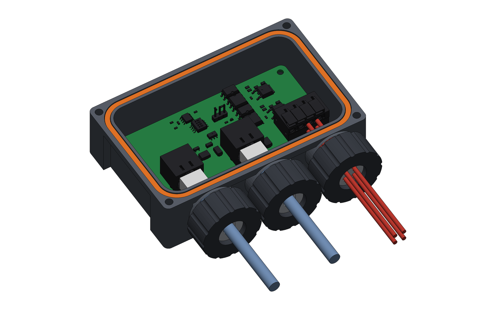
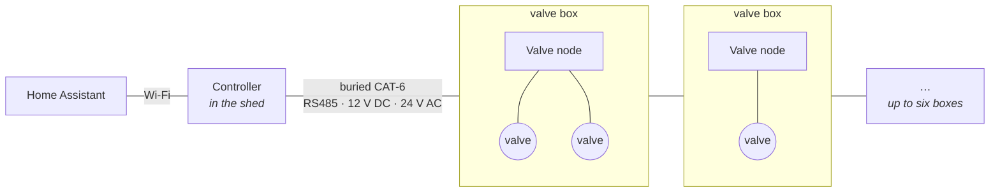
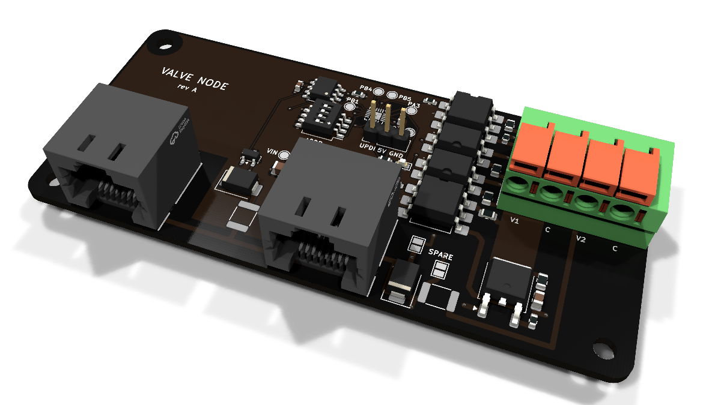
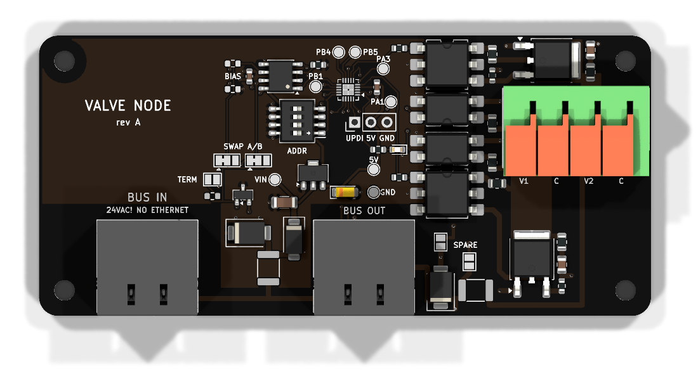
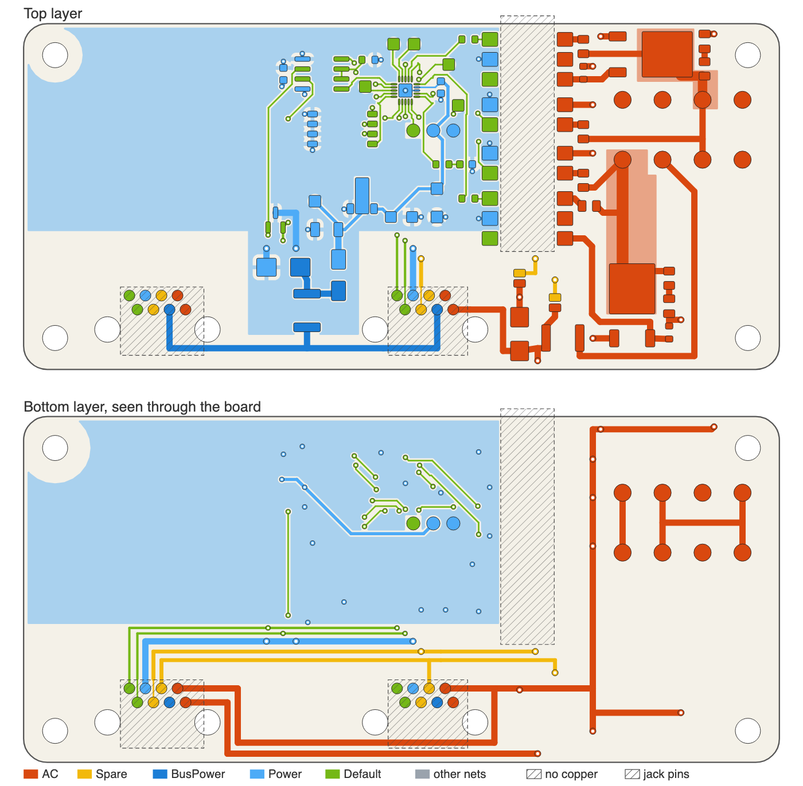
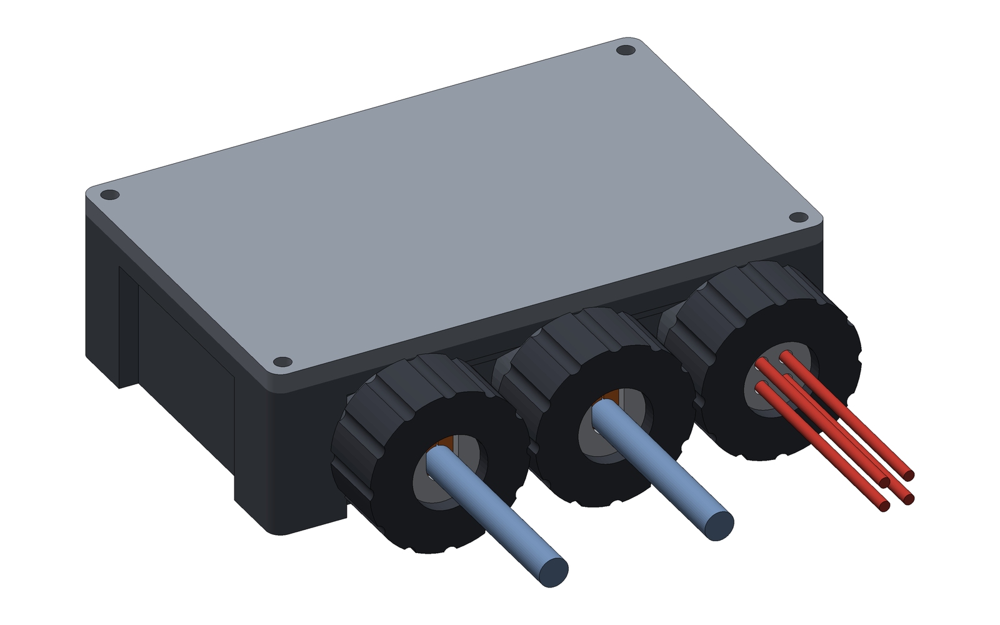
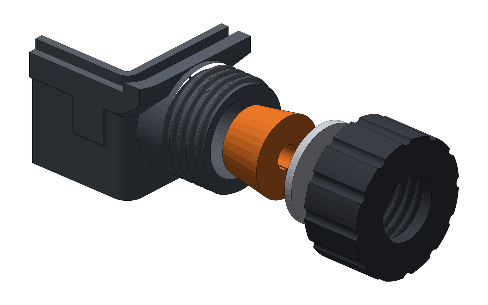
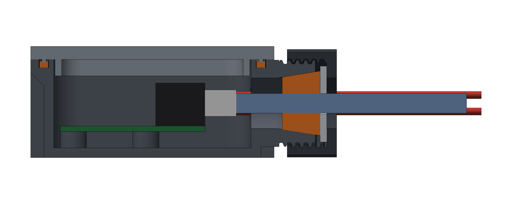

<h1 align="center">Irrigation controller</h1>

<p align="center">
  <b>Open hardware for a garden irrigation system run from Home Assistant:</b><br>
  sealed valve nodes in the ground, one buried cable, a controller in the shed.
</p>

<p align="center">
  
</p>
<p align="center"><sub>The valve node, lid off. A render of the design files. No board has been made yet.</sub></p>

## What it is

Sprinkler valves sit in plastic boxes in the ground. A buried network cable (CAT-6) runs from the
shed through every box, one after the other. This project replaces the electronics on both ends of
that cable:

- **Valve node**, one per box: a small board in a sealed, 3D-printed enclosure that switches the
  24 V AC solenoid valves.
- **Controller**, in the shed: powers the cable and connects it to Home Assistant through ESPHome.



The four pairs of the cable carry the data bus (RS485, Modbus RTU), 12 V DC for the logic,
24 V AC for the valves and one spare pair. Up to six boxes share less than 100 m of cable.

**Why new hardware.** The nodes in use today are mostly hobby modules on perfboard. A node keeps
a valve open for as long as it has power, even when the controller is gone. It cannot tell whether
a valve opened, and its address is compiled into its firmware. The new node fixes each of these and
is built to survive surges on the buried cable and damp in the valve box.

## The valve node

<p align="center">
  
  
</p>

A two-layer board of 96 × 44 mm. The bus enters on one jack and leaves on the other; the valve
wires go into the spring terminal block on the right.

- **Switches the valves with triacs.** Two outputs are populated, there is room for four. One
  valve runs at a time, because the transformer and the cable are sized for one.
- **Keeps 24 V AC away from the logic.** Optocouplers are the only parts that cross from one side
  to the other. 24 V AC copper keeps at least 3 mm from everything else, and the design rule check
  enforces it on every build.
- **Knows whether a valve works.** Each output has a monitor that sees a broken valve wire before
  the valve is opened, and sees whether the output really conducts once it is.
- **Closes on its own.** All valves close after 60 seconds without a request from the controller, and
  any valve after two hours open. A watchdog resets a hung microcontroller, and a reset closes the
  valves.
- **Survives the cable.** TVS diodes clamp surges on each pair where it enters the board and do
  not wear out with each surge. A short in one node's supply or valve wiring blows a fuse in that
  node instead of taking down the others.
- **One firmware for all nodes.** The address is set with a DIP switch on the board.
- **Nothing to solder.** JLCPCB assembles every part, including the connectors. About $22 per board
  in a batch of five, before shipping and import tax.

<p align="center">
  
</p>
<p align="center"><sub>Copper by net class. Orange carries 24 V AC, blue and green are logic; the hatched strip in between holds no copper on either layer.</sub></p>

## The enclosure

<p align="center">
  
  
</p>

Everything mechanical is printed: base, lid and nuts in ASA, gasket and cable seals in TPU. Only
the screws and the brass inserts they go into are bought.

- **All three cables enter through one wall,** which keeps the box at 114 × 93 × 34 mm.
- **A crimped network plug fits through the entry.** The soft seal of a bus entry is slit, so it
  goes onto the cable after the plug has passed. Tightening the nut pushes the seal into a cone,
  which squeezes it onto the cable.
- **The lid stops on the rim.** A ridge under the lid presses into a printed gasket by a set
  amount, however hard the screws are turned.
- **Every plug can be pulled with the board installed.** An automated collision check proves that
  board, plugs and enclosure do not overlap.

<p align="center">
  
</p>
<p align="center"><sub>Section through a bus entry: the stiff cable runs in a straight line through the seal into its jack.</sub></p>

## Everything is source text

No one draws this design in KiCad or a CAD program. Each board is a set of text files, and one
command turns them into everything a manufacturer needs:

| Step | Tool | Source |
|---|---|---|
| Schematic | [Zener](https://github.com/diodeinc/pcb), generated into KiCad 10 | `boards/<board>/<board>.zen` |
| Placement and routing | Python against KiCad's `pcbnew`, with a small grid router | `boards/<board>/layout.py` |
| Checks | KiCad's electrical and design rule checks, with the board's own rules | generated |
| Fabrication data | Gerbers, bill of materials and placement file for JLCPCB, board STEP | generated |
| Enclosure | [build123d](https://github.com/gumyr/build123d) | `boards/<board>/enclosure.py` |
| Fit | Collision check of the populated board against every enclosure part | generated |

Board and enclosure share one file of outline, mounting holes and connector positions
(`mech.json`), so they cannot drift apart. `make selftest` breaks the design on purpose (a lid
pushed into a jack, a ground track next to 24 V AC copper) and expects the checks to fail, so a
clean report means something. An AI coding agent does the design work in these files. The owner
reviews each board at three hold points (specification, schematic, layout and enclosure) and
places every order.

## Status

- **Valve node:** specification, schematic, layout, fabrication data and enclosure are done and
  were signed off by 2026-11-15. A change made the same day (bus termination moved to the
  controller, nothing left to solder by hand) awaits sign-off of schematic and
  layout. The enclosure had a first test print; nothing is ordered yet, and no real board exists. The firmware is not written
  yet.
- **Controller:** not designed yet. Until it is, the new nodes run with the existing controller.

## Quick start

Requires macOS on Apple Silicon, KiCad 10 in `/Applications`, [`uv`](https://docs.astral.sh/uv/) and `make`.

```bash
make setup                  # pinned tools into .tools/, nothing installed system-wide
make all                    # throwaway board: schematic -> checks -> layout -> fabrication data -> enclosure -> collision check
make all BOARD=valve-node   # the same for the valve node, about two minutes
make help                   # one command per output
```

Outputs land in `build/<board>/`. The generated KiCad project in `boards/<board>/eda/` opens in
KiCad 10 without any of the tools above.

## Documentation

| Question | Page |
|---|---|
| How does the chain work, what does each command produce, where is it weak? | [`docs/toolchain.md`](docs/toolchain.md) |
| What runs on the cable: wiring, addresses, registers, timing? | [`docs/bus-protocol.md`](docs/bus-protocol.md) |
| What is installed today, and what is wrong with it? | [`docs/existing-system.md`](docs/existing-system.md) |
| What does the valve node have to do, and why these parts? | [`docs/valve-node-spec.md`](docs/valve-node-spec.md) |
| What did the schematic add, and what was checked? | [`docs/valve-node-schematic.md`](docs/valve-node-schematic.md) |
| How does the enclosure seal, and how is it printed? | [`docs/valve-node-enclosure.md`](docs/valve-node-enclosure.md) |
| Where do the parts sit, how is 24 V AC kept from the logic, what does an order cost? | [`docs/valve-node-layout.md`](docs/valve-node-layout.md) |
| What does the valve node do on the bus, and how is its firmware built and tested? | [`docs/valve-node-firmware.md`](docs/valve-node-firmware.md) |
| How do I add a part and map it to a JLCPCB part number? | [`lib/README.md`](lib/README.md) |
| Which license covers what? | [`docs/license.md`](docs/license.md) |
| Rules and conventions for agents and contributors | [`CLAUDE.md`](CLAUDE.md) |

## License

Hardware: [CERN-OHL-P-2.0](LICENSES/CERN-OHL-P-2.0.txt). Software: [MIT](LICENSES/MIT.txt).
Documentation: [CC-BY-4.0](LICENSES/CC-BY-4.0.txt). Details and exceptions in [`docs/license.md`](docs/license.md).
