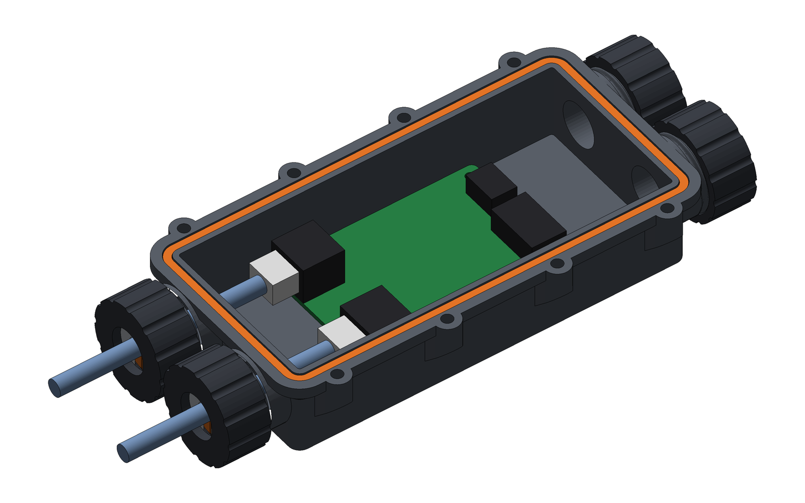
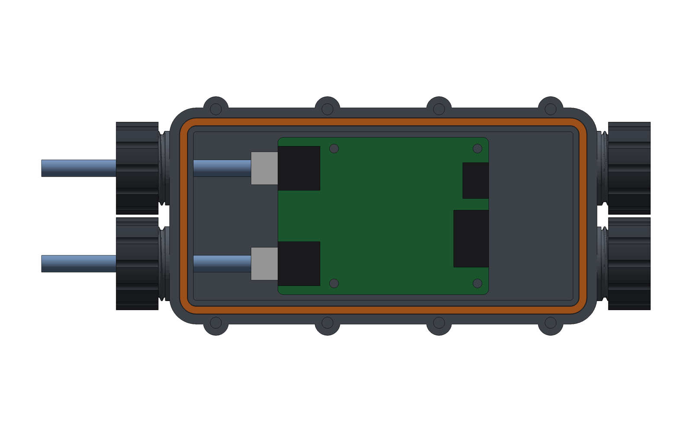

# Valve node: enclosure and board outline

The sealed box the valve node lies in, and the board outline that follows from it. The outline,
the mounting holes and the connector positions in
[`boards/valve-node/mech.json`](../boards/valve-node/mech.json) are the input to the layout.

Status: proposal, 2026-11-14. Nothing is printed yet. Four dimensions are assumed until the owner
has measured them ([To measure](#to-measure)); they are parameters at the top of
[`enclosure.py`](../boards/valve-node/enclosure.py), and one command rebuilds everything.

The requirements come from [`valve-node-spec.md`](valve-node-spec.md), "Outline and connectors"
and "Cable entries". Where this page departs from them, [Deviations](#deviations-from-the-specification)
says why.

## What to review

| Output | Command | Files |
|---|---|---|
| Parts in place, for Fusion | `make enclosure BOARD=valve-node` | `build/valve-node/enclosure/*.step` |
| Parts to print, lying as they are printed | same | `build/valve-node/print/*.stl` |
| Pictures | same | `build/valve-node/views/*.png` |
| Fit of board and connectors | `make collide BOARD=valve-node` | report on the terminal |

The command takes about 50 seconds. STEP and STL files are not committed: they are 25 MB per
revision, and the model, not its output, is the source. The pictures on this page are copies of
`build/valve-node/views/`.

## The box

| | |
|---|---|
| Outside | 177 × 85 × 34 mm, 190 mm long over the nuts |
| Inside | 135 × 60 × 27 mm |
| Walls and floor | 3 mm |
| Parts | Base, lid, gasket, four cable entries (nut, washer and insert each) |
| Hardware | 8 screws M3 × 10 for the lid, 4 screws M3 × 6 for the board, 12 heat-set inserts M3 (4.6 mm outside, 5.7 mm long), all stainless or brass |
| Material | ASA for base, lid, nuts and washers (PETG as fallback); TPU 95A for gasket and inserts |

Why it has this shape:

- **Cable entries on the two short walls, in line with the connectors.** The bus cable is stiff
  and its aluminium strands break when bent
  ([`existing-system.md`](existing-system.md#cable)). Each bus cable therefore runs straight from
  its entry into its jack: the plug is pushed through the entry and into the jack along one line,
  with the nut loose.
- **30 mm between each board end and the wall.** On the bus side that is the part of the plug
  that stands out of the jack plus room for a finger or a screwdriver on the latch. On the valve
  side it is the screw plug and the bend of the wires. It is the first number to shrink if the
  box turns out too long for a valve box.
- **The cable entries set the height.** An entry that an RJ45 plug passes through needs a thread
  of 26 mm and a nut of 33 mm. The entry's axis is at the jack's opening, the nut's lower edge
  ends level with the underside of the box, and the rim of the base lies just above the entry.
  That gives 20 mm of room above the board where the jacks need 13 mm.
- **The lid is flat and the base is deep**, so the seal lies above everything that could collect
  water inside, and the board, the plugs and the nuts are reachable with the lid off.

## Seal between base and lid

A flat ring of TPU, 2.6 mm wide and 2.0 mm high, lies in a groove in the rim of the base (3.0 mm
wide, 2.5 mm deep). A ridge under the lid, 1.2 mm wide, reaches 1.0 mm into the groove and
presses 0.5 mm into the ring.

- The lid stops on the rim. How far the gasket is compressed is set by the geometry and not by
  how hard a screw is turned, and the screws cannot crush it.
- A narrow ridge and not a flat face: TPU 95A is hard for a gasket. The same screw force on a
  narrow line gives a higher pressure, and a 2 mm ring compressed over its full width would hold
  the lid open.
- The screws sit outside the gasket. No screw hole leads inside, so the heat-set inserts need no
  sealing.
- Eight screws, 40 mm apart along the long sides. The short sides carry the cable entries and
  have no screws; a rim under the lid, 3 mm deep, stiffens it there and centres it in the box.
- The fallback, if a printed ring does not seal: a 2.5 mm round cord of silicone or EPDM fits the
  same groove; the ridge under the lid is then shortened to 0.5 mm (`TONGUE_H`).

## Cable entries

All four entries are the same: a threaded boss on the wall with a conical seat inside, a soft
insert, a stiff washer and a nut. Only the insert and its washer differ.

| Insert | Holes | Slit | Used for |
|---|---|---|---|
| `bus` | One, for the cable jacket | Yes | Each of the two bus cables |
| `valve-2` | Two, one per wire | No | A box with one valve |
| `valve-4` | Four | No | A box with two valves |
| `sensor` | One | No | Moisture sensor cable |
| `blank` | None | No | An entry that is not used |

How it seals. The seat is a cone that narrows towards the inside by 9° per side. The insert has
the same cone and stands 1.5 mm out of the boss when the nut is hand-tight. Tightening the nut
pushes it in until the washer meets the tip of the boss; the cone squeezes the insert by 0.24 mm
on its radius, onto the cable and against the seat. Every hole is 0.2 mm smaller than the cable.
As with the lid, the stop is a hard face and not a feeling.

Why a washer. The nut's opening has to be as large as the plug (15.5 mm), which leaves a ring of
2 mm to press on a 20 mm insert; the soft material would bulge out through the opening. The
washer closes the opening down to the cable. The bus washer has a slot so that it goes around a
cable with a plug on it.

Why the thread is its own. A printed thread needs a coarse pitch and play
([`tools/printthread.py`](../tools/printthread.py)): 2.5 mm pitch, 1.2 mm deep, 0.3 mm of play on
every side. No bought nut fits, and none is meant to.

## Board outline

| Item | Value | Reason |
|---|---|---|
| Board | 75 × 56 mm, corners 2 mm, 1.6 mm thick | See deviation 1 |
| Clearance to the long walls | 2 mm | Board drops in without tilting |
| Mounting holes | (20, 4), (71, 4), (20, 52), (71, 52), 3.2 mm for M3 | The left pair sits behind the jacks, because the jacks occupy the corners |
| Bus jacks | Front face on the left edge, centres at y = 11 and y = 45 | 34 mm apart: two 33 mm nuts side by side. Fixed: the entries are aligned with them |
| Valve headers | Front face on the right edge, centres at y = 31 and y = 41.16 | May move along the edge; the wires are flexible |
| Moisture terminal | Front face on the right edge, pin 1 at y = 19.2 | Moved from the top edge, see deviation 3 |
| Keep-out, top | 7 mm circle around each hole | Screw head |
| Keep-out, bottom | 9 mm circle around each hole | Standoff, 8 mm |
| Height above the board | 18 mm | Lid underside at 20.4 mm |
| Depth below the board | 3.5 mm | Floor at 5 mm |

The valve headers and the moisture terminal are 4 mm apart on the right edge. The layout's
isolation gap (3 mm between the 24 VAC side and the logic) passes between them.

## Deviations from the specification

| # | Specification | This design | Reason |
|---|---|---|---|
| 1 | Board about 75 × 52 mm, jacks side by side, holes in the four corners | 75 × 56 mm, jacks 34 mm apart at the corners of the left edge, left holes at x = 20 | Two entries that a plug passes through cannot be closer than their nuts. Keeping the jacks side by side would bend each stiff cable by 8 mm on its last 30 mm. The pass-through between the jacks grows from a few millimetres to about 18 mm; the surge protection still sits between the jacks |
| 2 | Valve and sensor inserts with a slit per hole | Closed holes | These wires have free ends and are pushed through. A closed hole seals better than a slit one, and only the bus cable carries a plug |
| 3 | Moisture terminal on the top edge | On the right edge, above the valve headers | A plug on a long edge would widen the box by 20 mm for an option that is not populated. The right edge has room since the board has two outputs |
| 4 | Entry: opening, insert, nut | A washer between nut and insert | See [Cable entries](#cable-entries) |
| 5 | One entry per valve | One entry for all valve wires of a box, with a two-hole or four-hole insert | Three entries do not fit on the short wall. The fourth entry is the sensor's, closed with a blank insert until a sensor is fitted |
| 6 | Nut of PETG | Nut of the box's material (ASA) | One material for all stiff parts; PETG remains the fallback for all of them |

## Printing

| Part | Material | How it lies | Note |
|---|---|---|---|
| `base` | ASA | Floor down | Support only under the four bosses, 3 mm high. The undersides of rim and screw tabs slope at 45° and need none |
| `lid` | ASA | Top face down | |
| `nut-4x` | ASA | End wall down | Thread axis upright, no support |
| `washer-*` | ASA | Flat | |
| `gasket-tpu` | TPU 95A | Flat | 10 layers at 0.2 mm |
| `insert-*-tpu` | TPU 95A | Large end down | 100 % infill |

For water-tightness: at least 5 perimeters (the walls are then solid), 100 % infill for the base
and the lid, 0.2 mm layers. The bosses print lying down, so their thread is the roughest surface
of the print; the play is sized for that.

## Checks

| Check | Result |
|---|---|
| Every part is a valid solid | `enclosure.py` stops otherwise |
| Board outline with connector blocks against every part (`make collide BOARD=valve-node`) | no overlap |
| The same with the lid lowered by 8 mm into the jacks (`make selftest`) | overlap reported, as it must be |
| Nut against boss thread | By construction: the nut's thread is the boss's thread grown by 0.3 mm. OpenCascade returns wrong volumes when two thread solids are intersected, so this pair is not checked by the script |
| Soft parts against stiff parts | Not checked: gasket and inserts are meant to be compressed |

Until the layout exists, the collision check runs against `build/valve-node/envelope.step`: the
board outline from `mech.json` with each connector as a block of its datasheet size. With a
layout, `make collide` uses the real board STEP.

## What does not hold up yet

1. **Nothing is printed.** Whether the slit bus insert, the printed gasket and the printed thread
   seal is decided by the water bath test (24 h under water, paper towel inside), with the real
   cable in the entries. Print one base, one lid and the entry parts before the board is ordered:
   the same print is the test fit for the layout hold point.
2. **Four dimensions are assumed** ([To measure](#to-measure)).
3. **The two nuts on a wall are 1 mm apart.** They turn, but fingers do not fit between them; each
   is gripped from above and below.
4. **The height of the jack's plug opening is assumed** (7 mm above the board, the middle of a
   13.2 mm body). The bore is 15.5 mm for a 6 mm cable, so a few millimetres do not matter; the
   board STEP will show it.
5. **Plugs are not in the collision check.** The RJ45 plugs are drawn in the pictures; the valve
   screw plugs are not modelled. The 30 mm on each side is the allowance for them.
6. **Opening a box in the ground** means eight screws. That is the price of screws outside the
   gasket and a lid that stays flat.

## To measure

The owner, with a caliper, before the first print. Each value is one line at the top of
`enclosure.py`.

| Parameter | Assumed | What to measure |
|---|---|---|
| `BUS_CABLE_D` | 6.0 mm | Outer diameter of the bus cable |
| `VALVE_WIRE_D` | 2.2 mm | Outer diameter of one valve wire with insulation |
| `PLUG_BORE_D` | 15.5 mm | Diagonal of the crimped RJ45 plug including the pressed-down latch, plus 1 mm |
| `SENSOR_CABLE_D` | 4.5 mm | Outer diameter of a moisture sensor cable, once a sensor is chosen |
| | 190 × 85 × 34 mm | Does the box fit into each valve box next to the valves? |

## Handed to the layout

- `mech.json` is the interface: outline, holes, connector positions with rotation, keep-outs,
  height limits. `tools/kilayout.py` reads outline and holes today; connectors and keep-outs are
  new keys for the layout script to use.
- Connectors are keyed by their name in the Zener source (`J_IN`, `OUT1.J`), because Zener
  renumbers reference designators.
- The rotations (270° for the jacks, 90° for the right-edge connectors) follow from the
  footprints' plug side being +y; check them in the first board render.
- The moisture terminal moved to the right edge. Its footprint spans 12.8 mm along the edge.
- When the layout moves a connector that is not `fixed`, it changes `mech.json`, and
  `make enclosure collide` has to pass again.
