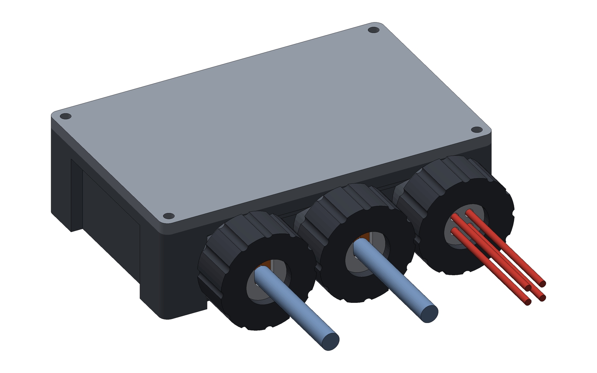
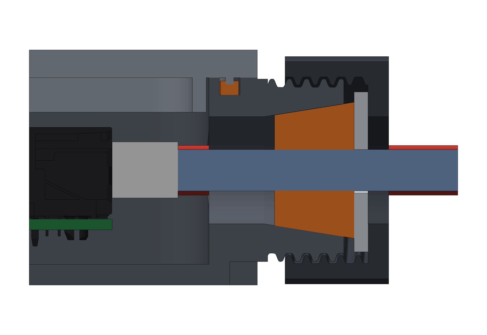
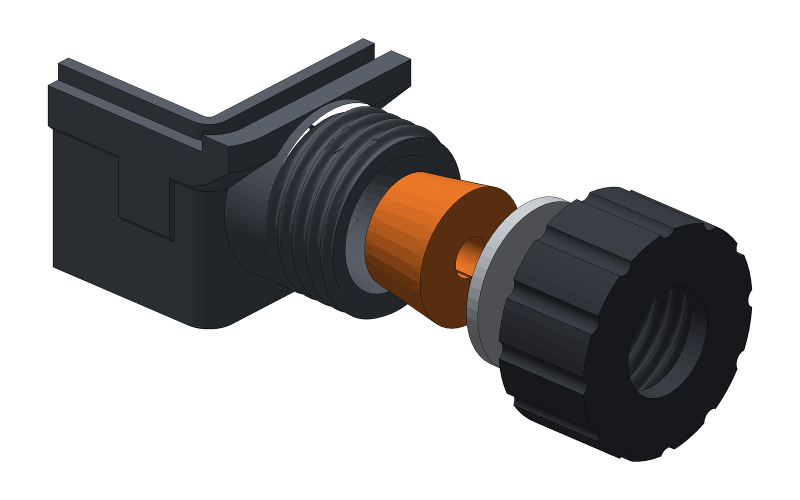

# Valve node: enclosure and board outline

The sealed box the valve node lies in, and the board outline that follows from it. The outline,
the mounting holes and the connector positions in
[`boards/valve-node/mech.json`](../boards/valve-node/mech.json) are the input to the layout.

Status: approved by the owner on 2026-11-14 as input to the layout (second version: a box the
size of a surface-mounted junction box, no cable entry for the moisture sensor). The layout exists
now ([`valve-node-layout.md`](valve-node-layout.md)); it moved the valve headers by 0.2 mm each.
Nothing is printed yet; the test fit is part of the layout hold point. Three dimensions are assumed until the owner
has measured them ([To measure](#to-measure)); they are parameters at the top of
[`enclosure.py`](../boards/valve-node/enclosure.py), and one command rebuilds everything.

The requirements come from [`valve-node-spec.md`](valve-node-spec.md), "Outline and connectors"
and "Cable entries". Where this page departs from them, [Deviations](#deviations-from-the-specification)
says why.

## What to review

| Output | Command | Files |
|---|---|---|
| Parts in place, for Fusion | `make enclosure BOARD=valve-node` | `build/valve-node/enclosure/*.step` |
| Parts to print, lying as they are printed | same | `build/valve-node/print/*.stl` |
| Pictures | same | `build/valve-node/views/*.png` |
| Fit of board and connectors | `make collide BOARD=valve-node` | report on the terminal |

The command takes about 40 seconds. STEP and STL files are not committed: they are 20 MB per
revision, and the model, not its output, is the source. The pictures on this page are copies of
`build/valve-node/views/`.

## The box

| | |
|---|---|
| Outside | 114 × 93 × 34 mm over the nuts; the body alone is 114 × 74 mm |
| Inside | 100 × 60 × 27 mm |
| Walls and floor | 3 mm, solid pillars in the four corners |
| Parts | Base, lid, gasket, three cable entries (nut, washer and insert each) |
| Hardware | 4 screws M3 × 10 for the lid, 4 screws M3 × 6 for the board, 8 heat-set inserts M3 (4.6 mm outside, 5.7 mm long), all stainless or brass |
| Material | ASA for base, lid, nuts and washers (PETG as fallback); TPU 95A for gasket and inserts |

Why it has this shape:

- **All three cables enter through one wall.** A cable entry with its nut is 23 mm long. With
  entries on two opposite walls the first version was 190 mm long; with all of them on one wall
  the box is as wide as three nuts side by side (114 mm) and as deep as the board plus one entry
  (93 mm).
- **Each bus cable runs straight into its jack.** The cable is stiff and its aluminium strands
  break when bent ([`existing-system.md`](existing-system.md#cable)). The jacks and the valve
  headers sit on one edge of the board, each opposite its entry: the plug is pushed through the
  entry and into the jack along one line, with the nut loose.
- **14 mm between the board's connector edge and the wall.** The plug stands 9.5 mm out of the
  jack; its rear end lies just inside the wall. The jack's latch is on top (seen in the 3D model
  of the RJHSE-5080 that the footprint carries), so with the lid off it is pressed from above. To
  unplug: take off nut, washer and insert, press the latch, pull the cable out through the entry,
  the way it went in. The board stays in place.
- **Lid screws in the corners, inside the outline.** The cavity's corners are rounded with 8 mm.
  The gasket follows that curve, and each corner outside it is a solid pillar that takes a
  heat-set insert. Nothing stands out beyond the rim except the nuts.
- **The cable entries set the height.** An entry that an RJ45 plug passes through needs a thread
  of 26 mm and a nut of 33 mm. The entry's axis is at the jack's opening, the nut's lower edge
  ends level with the underside of the box, and the rim of the base lies just above the entry.
  That gives 20 mm of room above the board where the jacks need 13 mm.

## Seal between base and lid

A flat ring of TPU, 2.6 mm wide and 2.0 mm high, lies in a groove in the rim of the base (3.0 mm
wide, 2.5 mm deep). A ridge under the lid, 1.2 mm wide, reaches 1.0 mm into the groove and
presses 0.5 mm into the ring.

- The lid stops on the rim. How far the gasket is compressed is set by the geometry and not by
  how hard a screw is turned, and the screws cannot crush it.
- A narrow ridge and not a flat face: TPU 95A is hard for a gasket. The same screw force on a
  narrow line gives a higher pressure, and a 2 mm ring compressed over its full width would hold
  the lid open.
- The screws sit outside the gasket. No screw hole leads inside, so the heat-set inserts need no
  sealing.
- Four screws, 106 and 66 mm apart. That is far for a gasket, so the lid is 4 mm thick and
  carries a rib of 2 × 5 mm all around, just inside the wall, which keeps it flat between the
  screws and centres it in the box. Whether that is enough is one of the things the water bath
  test answers; the fix would be a softer gasket (printed with less infill) or a shallower ridge.
- The fallback, if a printed ring does not seal: a 2.5 mm round cord of silicone or EPDM fits the
  same groove; the ridge under the lid is then shortened to 0.5 mm (`TONGUE_H`).

## Cable entries

All three entries are the same: a threaded boss on the wall with a conical seat inside, a soft
insert, a stiff washer and a nut. Only the insert and its washer differ.

| Insert | Holes | Slit | Used for |
|---|---|---|---|
| `bus` | One, for the cable jacket | Yes | Each of the two bus cables |
| `valve-2` | Two, one per wire | No | A box with one valve |
| `valve-4` | Four | No | A box with two valves |
| `blank` | None | No | An entry that is not used: the second bus entry of the last node on the cable |

How it seals. The seat is a cone that narrows towards the inside by 9° per side. The insert has
the same cone and stands 1.5 mm out of the boss when the nut is hand-tight. Tightening the nut
pushes it in until the washer meets the tip of the boss; the cone squeezes the insert by 0.24 mm
on its radius, onto the cable and against the seat. Every hole is 0.2 mm smaller than the cable.
As with the lid, the stop is a hard face and not a feeling.

Why a washer. The nut's opening has to be as large as the plug (15.5 mm), which leaves a ring of
2 mm to press on a 20 mm insert; the soft material would bulge out through the opening. The
washer closes the opening down to the cable. The bus washer has a slot from its rim to its centre,
as wide as the cable, and is pushed onto the cable from the side; the nut, whose opening the plug
passes through, is threaded over the plug before that.

Why the thread is its own. A printed thread needs a coarse pitch and play
([`tools/printthread.py`](../tools/printthread.py)): 2.5 mm pitch, 1.2 mm deep, 0.3 mm of play on
every side. No bought nut fits, and none is meant to.

## Board outline

| Item | Value | Reason |
|---|---|---|
| Board | 96 × 44 mm, corners 3 mm, 1.6 mm thick | See deviation 1. The same area as 75 × 56 mm |
| Clearance to the walls | 2 mm on three sides, 14 mm on the connector edge | Board drops in without tilting; the rounded corners of the cavity clear the board's corners by 0.8 mm |
| Mounting holes | (4, 4), (92, 4), (4, 40), (92, 26), 3.2 mm for M3 | The fourth sits behind the valve headers, which occupy that corner |
| Bus jacks | Front face on the bottom edge (y = 44), centres at x = 17 and x = 51 | 34 mm apart: two 33 mm nuts side by side. Fixed: the entries are aligned with them |
| Valve headers | Front face on the bottom edge, centres at x = 79.72 and x = 90.28 | Their entry is at x = 85. May move along the edge; the wires are flexible. The layout set them 0.4 mm apart instead of body against body |
| Keep-out, top | 7 mm circle around each hole | Screw head |
| Keep-out, bottom | 9 mm circle around each hole | Standoff, 8 mm |
| Height above the board | 18 mm | Lid underside at 20.4 mm |
| Depth below the board | 3.5 mm | Floor at 5 mm |

All connectors are on one edge. From left to right: jack, jack, valve headers. The 24 VAC side of
the board is its right part, behind the valve headers; the logic is the left part and the strip
along the far edge. Whether the circuit fits on 96 × 44 mm with that split is for the layout to
show; the area is that of the outline the specification proposed.

## Deviations from the specification

| # | Specification | This design | Reason |
|---|---|---|---|
| 1 | Board about 75 × 52 mm, jacks side by side on one short edge, valve headers on the opposite one, holes in the four corners | 96 × 44 mm, all connectors on one long edge, jacks 34 mm apart | All cables through one wall makes the box 114 mm long instead of 190 mm. Two entries that a plug passes through cannot be closer than their nuts, so the jacks are 34 mm apart; the pass-through between them is about 18 mm long instead of a few millimetres, and the surge protection still sits between the jacks |
| 2 | Valve inserts with a slit per hole | Closed holes | These wires have free ends and are pushed through. A closed hole seals better than a slit one, and only the bus cable carries a plug |
| 3 | Cable entry and terminal on the edge for a moisture sensor | No entry and no terminal | Owner, 2026-11-14: the sensor never worked properly. The schematic dropped the input as well ([schematic deviation 5](valve-node-schematic.md#deviations-from-the-specification)) |
| 4 | Entry: opening, insert, nut | A washer between nut and insert | See [Cable entries](#cable-entries) |
| 5 | One entry per valve | One entry for all valve wires of a box, with a two-hole or four-hole insert | A third and fourth entry would each widen the box by 34 mm |
| 6 | Nut of PETG | Nut of the box's material (ASA) | One material for all stiff parts; PETG remains the fallback for all of them |
| 7 | Cable entries on two opposite walls | All on one wall | The owner asked for a box the size of a surface-mounted junction box; see deviation 1 |

## Printing

| Part | Material | How it lies | Note |
|---|---|---|---|
| `base` | ASA | Floor down | Support only under the three bosses, 3 mm high. The underside of the rim slopes at 45° and needs none |
| `lid` | ASA | Top face down | |
| `nut-3x` | ASA | End wall down | Thread axis upright, no support |
| `washer-*` | ASA | Flat | |
| `gasket-tpu` | TPU 95A | Flat | 10 layers at 0.2 mm |
| `insert-*-tpu` | TPU 95A | Large end down | 100 % infill |

For water-tightness: at least 5 perimeters (the walls are then solid), 100 % infill for the base
and the lid, 0.2 mm layers. The bosses print lying down, so their thread is the roughest surface
of the print; the play is sized for that.

## Checks

| Check | Result |
|---|---|
| Every part is a valid solid | `enclosure.py` stops otherwise |
| Populated board (STEP from the layout) against every part (`make collide BOARD=valve-node`) | no overlap |
| The same with the lid lowered by 8 mm into the jacks (`make selftest`) | overlap reported, as it must be |
| Nut against boss thread | By construction: the nut's thread is the boss's thread grown by 0.3 mm. OpenCascade returns wrong volumes when two thread solids are intersected, so this pair is not checked by the script |
| Soft parts against stiff parts | Not checked: gasket and inserts are meant to be compressed |

The collision check uses the board STEP that `make fab` writes. Without it (a board that has no
layout yet) it falls back to `build/valve-node/envelope.step`: the board outline from `mech.json`
with each connector as a block of its datasheet size. The same blocks are the printable
`board-dummy.stl` for the test fit ([`valve-node-layout.md`](valve-node-layout.md), "Test fit").
The pictures on this page show the real board.

## What does not hold up yet

1. **Nothing is printed.** Whether the slit bus insert, the printed gasket and the printed thread
   seal is decided by the water bath test (24 h under water, paper towel inside), with the real
   cable in the entries. Print one base, one lid and the entry parts before the board is ordered:
   the same print is the test fit for the layout hold point.
2. **Three dimensions are assumed** ([To measure](#to-measure)).
3. **The nuts are 1 mm apart.** They turn, but fingers do not fit between them; each is gripped
   from above and below.
4. **Four lid screws for 320 mm of gasket.** See [Seal between base and lid](#seal-between-base-and-lid).
5. **The height of the jack's plug opening was assumed** (7 mm above the board, the middle of a
   13.2 mm body). The section picture above now shows the jack's own 3D model: the drawn plug
   meets the opening. The bore is 15.5 mm for a 6 mm cable, so a few millimetres do not matter.
6. **Plugs are not in the collision check.** The RJ45 plugs are drawn in the pictures; the valve
   screw plugs are not modelled, and the 14 mm in front of the headers is the allowance for them.
   If a plug needs more, the headers move back on the board.

## To measure

The owner, with a caliper, before the first print. Each value is one line at the top of
`enclosure.py`.

| Parameter | Assumed | What to measure |
|---|---|---|
| `BUS_CABLE_D` | 6.0 mm | Outer diameter of the bus cable |
| `VALVE_WIRE_D` | 2.2 mm | Outer diameter of one valve wire with insulation |
| `PLUG_BORE_D` | 15.5 mm | Diagonal of the crimped RJ45 plug including the pressed-down latch, plus 1 mm |
| | 114 × 93 × 34 mm | Does the box fit into each valve box next to the valves? |

## Handed to the layout

- `mech.json` is the interface: outline, holes, connector positions with rotation, keep-outs,
  height limits. `tools/kilayout.py` reads outline and holes today; connectors and keep-outs are
  new keys for the layout script to use.
- Connectors are keyed by their name in the Zener source (`J_IN`, `OUT1.J`), because Zener
  renumbers reference designators.
- The rotation is 0° for all four connectors: the footprints' plug side is +y, which is the
  board's bottom edge. Confirmed in the board render and in the section picture above.
- When the layout moves a connector that is not `fixed`, it changes `mech.json`, and
  `make enclosure collide` has to pass again.
