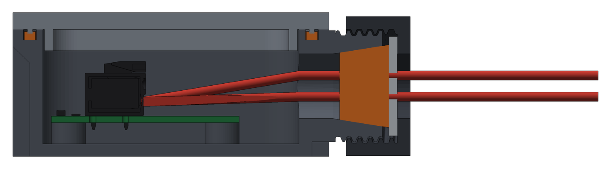
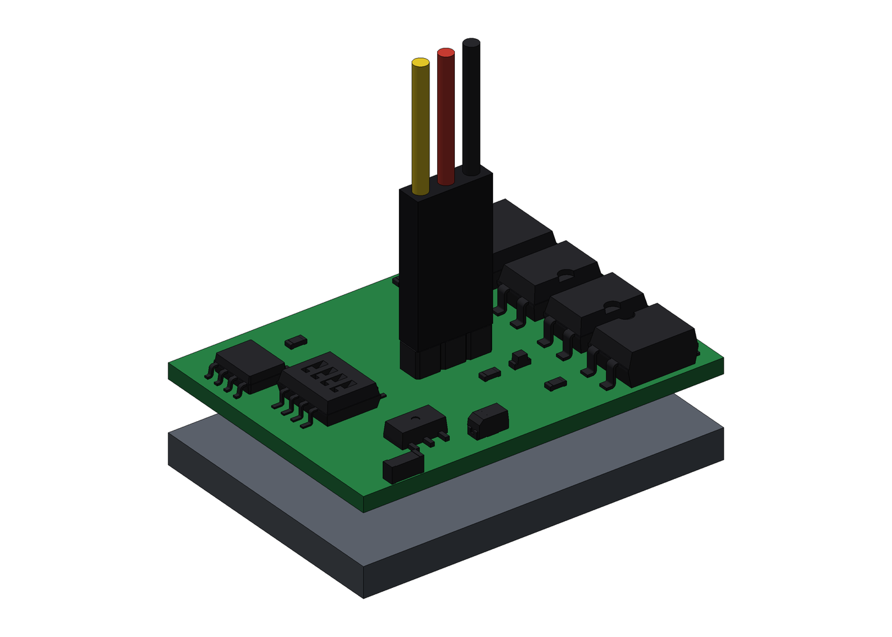

# Valve node: layout and fabrication data

The third of three hold points for the valve node, with the renders and the reports. Only the
owner orders, and only after the test fit.

Status: approved by the owner on 2026-11-15, then changed the same day by the owner's decision:
termination, bias and the A/B swap jumpers left the node and JLCPCB populates the UPDI header, so
that nothing on the node is soldered by hand ([The programming header](#the-programming-header),
deviation 8). The check before the order (2026-11-16) replaced three parts by equivalents and
removed the order number placeholder
([Check before the order](#check-before-the-order-2026-11-16)). The owner signed off the changed
schematic and layout on 2026-11-16 and did the test fit the same day: the 1:1 paper print of the
board on a printed base fits ([Test fit](#test-fit)). Nothing is ordered yet.

The circuit is in [`valve-node-spec.md`](valve-node-spec.md) and
[`valve-node-schematic.md`](valve-node-schematic.md), the box and the board outline in
[`valve-node-enclosure.md`](valve-node-enclosure.md). This page says where the parts sit and why,
how 24 VAC is kept away from the logic, what was checked, what the order costs and how to try the
fit before ordering.

## What to review

One command builds everything: `make all BOARD=valve-node` (about two minutes).

| Output | Command | File |
|---|---|---|
| Renders: top, bottom, at an angle | `make render BOARD=valve-node` | `build/valve-node/render-*.png` |
| Copper by net class, both layers | `make plots BOARD=valve-node` | `build/valve-node/plots/classes.svg` |
| Copper per side, assembly drawing with reference designators | same | `build/valve-node/plots/copper-*.svg`, `assembly-top.svg` |
| 1:1 print of the board for a test fit | same | `build/valve-node/plots/valve-node-1to1.pdf` |
| Design rules check | `make drc BOARD=valve-node` | `build/valve-node/drc.rpt` |
| Gerber and drill files, JLCPCB BOM and placement file, board STEP | `make fab BOARD=valve-node` | `build/valve-node/fab/` |
| Board in the enclosure, pictures and collision check | `make enclosure collide BOARD=valve-node` | `build/valve-node/views/`, terminal |

Sources: [`layout.py`](../boards/valve-node/layout.py) (every position, every rule, every scripted
track), [`mech.json`](../boards/valve-node/mech.json) (outline, holes, connector positions),
[`tools/kilayout.py`](../tools/kilayout.py) and [`tools/gridroute.py`](../tools/gridroute.py).

## Where the parts sit

96 × 44 mm, two layers, every part on the top side. The outline, the mounting holes and the
positions of the two bus jacks and the valve terminal block are shared with the enclosure
(`mech.json`).

| Area | Parts | Why there |
|---|---|---|
| Right third | Triacs, snubbers, gate and monitor resistors, the valve terminal block | The 24 VAC side. The terminal block stands at the far edge, its wire openings towards the cable entries. Output 2 sits behind it, output 1 in front of it, under the wires |
| One column at x = 64 mm | The four optocouplers | The only parts that span the isolation gap. Their pin rows are 7.5 mm apart, and nothing else crosses that line |
| Right of the OUT jack | 24 VAC TVS, valve fuse, the two spare-pair jumpers | The 24 VAC pair leaves the jack here, so the TVS is the first part on the pair |
| Between the jacks | 12 V fuse, 12 V TVS, series diode; RS485 TVS just above | Every bus wire passes here on its way from jack to jack, so each TVS sits on the wire it protects |
| Above the jacks | Regulator, transceiver, microcontroller, address switch, programming header | Logic. The microcontroller's output pins face the optocouplers, its UART pins the transceiver. The bus pair runs straight up from its TVS to the transceiver |
| Left third | Empty, ground copper | The outline is as long as the enclosure needs for three cable entries; the circuit needs less |

## 24 VAC and logic

Orange is everything that carries 24 VAC, yellow the spare pair, blue and green the logic. The
hatched strip is the isolation gap.

The rules of the specification ("Layout rules") are not a drawing convention but design rules in
the KiCad project (`boards/valve-node/eda/valve-node.kicad_dru`, written by `layout.py`). KiCad's
DRC checks them on every run:

| Rule | Value | How it is met |
|---|---|---|
| 24 VAC to anything else | 3.0 mm | The smallest distance on the board is 4.9 mm (a jumper pad to an optocoupler's unused pad). Along the gap, logic ends at x = 60.4 mm and 24 VAC starts at x = 67.8 mm |
| Inside class 24 VAC | 0.5 mm, tracks 0.8 mm | All 24 VAC tracks are 0.8 mm, the two tracks from a triac's tab to its terminal 1.5 and 1.2 mm |
| No copper under the optocouplers | both layers | A strip of 6.8 mm between the pin rows, over the whole column |
| Ground zone on the logic half only | | Two zones, both end at x = 60.4 mm and above the pass-through |
| Bus power | 0.8 mm | +12 V and ground from jack to jack |
| Spare pair | 3.0 mm to logic once it has left the pass-through | It can be bridged to the 24 VAC pair, so east of the OUT jack it is treated like it. Smallest distance there: 3.25 mm |
| Triac cooling | at least 0.5 cm² under each tab | 1.31 cm² (output 1) and 0.65 cm² (output 2), each joined to its valve terminal |

### The one exception: the jack

Inside the jack, 24 VAC and +12 V are neighbours at 1.02 mm pitch. The specification accepted
that. The rule is relaxed to 0.4 mm in two small areas around the pin fields (hatched, "jack
pins"), and only between two items that both lie inside. The smallest distance there is 0.65 mm,
between the pads of 24 VAC b and +12 V.

That distance was 0.45 mm with the footprint as fetched (pads 1.6 mm, holes 1.0 mm). The pads are
now 1.4 mm with 0.9 mm holes, which is what Amphenol's drawing asks for (0.89 mm), and the two
plastic pegs are unplated holes of 3.25 mm; they were plated holes without a pad.

The fetched footprint is from the EasyEDA library that LCSC's engineers draw for JLCPCB's parts.
Its holes were 0.1 mm larger than Amphenol's, most likely as a margin for the board maker's
tolerance, and that margin is gone now. What is left: JLCPCB makes a plated hole between 0.08 mm
smaller and 0.13 mm larger than ordered (capabilities page, read 2026-11-15), so a 0.9 mm hole
comes out between 0.82 and 1.03 mm. The jack's contact tails are 0.43 × 0.35 mm in its 3D model,
0.55 mm across the diagonal, which leaves 0.27 mm in the smallest hole. The pad keeps a ring of
0.25 mm around the hole, which is what JLCPCB recommends for a two-layer board; a 1.0 mm hole in
a 1.4 mm pad would leave 0.20 mm. Neither the tolerance on Amphenol's drawing nor the tail's
size was read from an Amphenol document; the 3D model came with the fetched footprint.

### The pass-through

Eight wires go from jack to jack, and the two jacks have the same pin order, so every wire has to
cross every other one once. How they do it decides how close 24 VAC comes to the logic.

- **North of the pins, bottom layer:** RS485 A and B, ground, and the spare pair, as five lanes.
  They leave the IN jack nested, without crossing. At the OUT jack each lane ends in a via and
  drops to its pin on the top layer. B and spare 2 are on the inner pin row and pass between two
  pads of the outer row with a 0.2 mm track and 0.22 mm on each side.
- **South of the pins, bottom layer:** the 24 VAC pair, 0.8 mm, along the board edge under the
  jacks. No via. It reaches the OUT jack from the right, through the TVS.
- **South of the pins, top layer:** +12 V. It is the only logic wire on that side, and it runs
  above the 24 VAC pair with the board between them: 1.6 mm of FR-4 instead of a gap on the
  surface.

Between the jacks, 24 VAC keeps the full 3 mm from every logic track on its own layer. The spare
pair does not. It runs next to the ground lane at 0.65 mm, as it does inside the cable. With its
jumpers open it is connected to nothing.

### Surge paths

| Pair | Path |
|---|---|
| RS485 | Each lane rises through a via straight into its TVS pad. The TVS's ground pad returns to the ground lane through 7 mm of 0.8 mm track and a via |
| +12 V | Lane, 2.7 mm to the fuse, 4 mm on to the TVS; the edge of the TVS's ground pad is 1.2 mm from a via into the ground lane |
| 24 VAC | Wire a passes through the TVS pad on its way to the OUT jack's pin. Wire b reaches the TVS through a via 1.3 mm from the pad |

### Valve outputs

The terminal block divides the 24 VAC side. Each output has its optotriac next to its triac and
its monitor optocoupler next to the block, where the valve node is at hand on a pin.

- **Output 2, behind the block.** Optotriac, gate-to-A1 resistor and gate lead lie on one line,
  7 mm of gate track. The gate resistor reaches the tab between the triac's two leads. The tab's
  copper area ends on the rear pin of pole 3. The monitor resistor reaches pole 3 on a track
  under the block, between its two pin rows.
- **Output 1, in front of the block.** The triac's tab points to the block and is joined to the
  front pin of pole 1 by 13 mm of copper area with a 1.5 mm track in it. The triac's body keeps
  9.8 mm from the block's wire openings ("The valve terminals"). The gate track is 22 mm long:
  it passes the tab on the left and reaches the gate lead between tab and leads, with 0.6 mm on
  each side. The gate-to-A1 resistor sits at the gate lead, the snubber beside the tab.
- **The block's pins.** Every pole has a rear and a front pin. Poles 1, 2 and 4 join theirs on
  the bottom layer, pole 3 on the top layer. That lets the fused common go from pole 2 to pole 4
  on the bottom layer, across pole 3, and output 2's monitor track cross poles 1 and 2 on the
  top layer.

24 VAC b reaches every part from a 0.8 mm trunk on the bottom layer, between the optocouplers
and the block, through eight vias. The valve current flows trunk, via, triac, tab, copper area,
valve terminal. The fused common runs along the board's lower edge and up to pole 2, outside
both outputs.

## The logic side

Everything above is drawn in `layout.py` by coordinates. The remaining 25 logic nets are connected
by a small router of this repository ([`tools/gridroute.py`](../tools/gridroute.py)): 0.1 mm grid,
two layers, 45° bends, shortest path first, no second attempts. It works inside a region that
ends before any 24 VAC copper, so it cannot come near it.

The throwaway board uses Freerouting. On this board Freerouting left 8 to 13 connections open
around the microcontroller in every run and wrote three tracks below the minimum width
([`toolchain.md`](toolchain.md), "What does not hold up"). The router here is cruder, but the same
input gives the same copper on every run, and a net that finds no way stops the build with its
name and a map of what blocks it.

- The microcontroller's pins are 0.4 mm apart. `layout.py` leads them outwards as a fan to
  0.8 mm pitch, where a via fits beside a neighbour's track; the router continues from there.
- Signal tracks are 0.2 mm with 0.2 mm space, supply tracks 0.4 mm.
- The address switch and the transceiver have their pins in the opposite order to the
  microcontroller's. The specification allows swapping pins for that; this layout does not use
  it and crosses on the bottom layer instead, so the pin assignment of the specification stands.
- Ground is a zone on each layer. Every ground pad also has its own via to the bottom zone,
  because the tracks cut the top zone into islands.

## Checks

| Check | Result |
|---|---|
| KiCad DRC, all severities, including the custom rules above | 0 violations, 0 unconnected pads |
| The 3 mm rule can fail: a ground track drawn 2.5 mm from 24 VAC copper on a copy of the board (`make selftest`) | reported, as it must be |
| The isolation gap can fail: a track drawn under an optocoupler | reported |
| The screw head keep-out can fail: a track drawn under a screw head | reported |
| Board STEP and the two mated bus plugs against every enclosure part (`make collide BOARD=valve-node`) | no overlap, 6 parts |
| The programming plug on the UPDI header, lid off, against every enclosure part but the lid and against the board | no overlap |
| The plug check can fail: the plug moved by half a pin pitch, so that the pins hit its housing (`make selftest`) | reported |
| Height: 14.8 mm above the board's bottom face, 1.7 mm below it | limits from the enclosure: 18 mm above the board, 3.5 mm below |
| Jack orientation in the render and in the enclosure section | plug opening faces the cable entry |
| Schematic: unchanged by the layout, ERC | 0 violations |
| Every populated part has an LCSC number (`make fab`) | 27 BOM lines, 39 placements, no footprint without a part |

The second and third self-test exist because of what the first version found: KiCad 10.0.1 did
not report a track inside a rule area that forbids tracks. The DRC report was clean and the check
was blind. Both keep-outs are now explicit rules in the rule file, and both are tested.

## Deviations

| # | Before | This layout | Reason |
|---|---|---|---|
| 1 | Bus jack footprint as fetched: pads 1.6 mm, holes 1.0 mm, pegs as plated holes of 3.3 mm | Pads 1.4 mm, holes 0.9 mm, pegs unplated 3.25 mm | Amphenol's drawing (schematic page, "Handed to the layout"); 0.65 mm instead of 0.45 mm between the 24 VAC and +12 V pads; a track fits between two pads |
| 2 | Two pluggable screw terminals for the valve wires (headers KF2EDGR-5.08-2P with loose plugs) | One spring terminal block with four poles and push buttons, KF142R-5.08-4P, soldered to the board | See "The valve terminals" below. The schematic changed with it |
| 3 | Fuses and triacs: the manufacturers draw longer land patterns than KiCad's (schematic page) | KiCad's patterns kept | They are the IPC-7351 patterns for reflow, which is how JLCPCB solders them. The longer ones add toe length for hand and wave soldering. The triac's cooling comes from the copper area, not from the pad |
| 4 | Silkscreen with reference designators | Function labels only: jacks, valves, jumpers, test pads, programming header | 54 footprints leave no room. The assembly drawing has the designators |
| 5 | Jack and terminal block silkscreen as fetched | Outline shortened to inside the board edge and off the pads | They drew over the edge and over pads; DRC reports both |
| 7 | 3D model of the terminal block as fetched: turned by 180°, wire openings facing the triacs | Turned and moved to match the pads, which agree with Kefa's drawing | The pads were right, the model was not. Found in the render; the collision check had passed with the wrong one |
| 6 | Specification: one clearance for the 24 VAC class | A second class for the spare pair | Open jumpers leave it floating; bridged, it is 24 VAC. It gets the 3 mm wherever it is not between the bus lanes |
| 8 | After the approval: terminator R14 with jumper JP5 and bias footprints R11, R12 left of the transceiver, swap jumpers JP1 and JP2 between TVS and transceiver, the UPDI header a footprint | All five gone; the bus pair runs from the TVS straight to the transceiver; the header populated. Nothing else moved | Owner, 2026-11-15: nothing on the node is soldered by hand (schematic deviations 7, 8 and 13) |

Not changed: the pin assignment and the board outline. The schematic and the bill of materials
changed in one place at the approval, the valve terminals, and after it in the RS485 part and
the programming header (deviation 8). One mounting hole moved with them, from (92, 26) to
the corner at (92, 40).

## Fabrication data

`make fab BOARD=valve-node` writes to `build/valve-node/fab/`:

| File | Content |
|---|---|
| `valve-node-gerbers.zip` | Copper, mask, paste, silkscreen, outline, drill files for plated and unplated holes |
| `valve-node-bom-jlcpcb.csv` | 27 lines with LCSC numbers |
| `valve-node-cpl-jlcpcb.csv` | 39 placements: 35 surface-mount parts and the 4 through-hole connectors |
| `valve-node.step` | The populated board, used by the collision check |

The placement file gives the middle of each part, which is where JLCPCB's own footprints have
their origin. For the footprints fetched from LCSC (bus jacks, valve terminal block) that is their
origin; for KiCad's it is the middle of the pads, which differs from KiCad's origin on the pin
header (2.54 mm, pin 1), the triacs (0.84 mm) and the regulator (0.3 mm). Until 2026-11-16 the file
gave KiCad's origin for all of them (found by the Codex review, below).

### Check before the order (2026-11-16)

| Point | Result |
|---|---|
| Stock and class of every part, JLCPCB part pages | All in stock for five boards after three changes: the green LED 19-217/GHC (C72043) had none and could only be pre-ordered, 378 at least; it is now the 19-21/GHC (C2986048, 42,531). The switch DSHP04TSGET (C40736) is marked as no longer made; it is now the DSHP04TSGER (C5301814, 2,373), the same switch on a reel. Fewest in stock: the jack with 617 (255 orderable), the valve fuse with 651 |
| Order number on the board | JLCPCB adds no mark by default (help article *How to mark on PCB?*, updated 2026-05-22); the order form offers only "Remove Mark" and a 2D barcode, no order number. The placeholder `JLCJLCJLCJLC` on the bottom silkscreen would have been printed as text and is gone |
| Board size for Economic assembly | 10 × 10 mm to 470 × 500 mm (JLCPCB PCB assembly capabilities); 96 × 44 mm needs no rails |
| Second opinion: Codex (OpenAI, `codex exec`, read-only) on sources, BOM, placement file and Gerbers | Three findings. Placement points not in the middle of the part: fixed (above). Fabrication files older than the part changes made during the review: rebuilt. Valve fuse F2 rated 60 V below the 77.4 V clamp of D4: now the 72 V type ([specification](valve-node-spec.md#faults-on-the-24-vac-side)). Found fine: BOM against netlist, pin maps of the polarised parts, outline, plated and unplated holes, UPDI, UART, RS485 A/B against the bus pinout, decoupling, triac drive, snubbers |
| JLCPCB's placement preview, first upload by the owner (2026-11-16) | Turned against the pads: U6 by 180°, J3, U2 and U4 by 90° (owner); U5 by 90° and D3 by 180°, with two leads over the single pad (read from the owner's screenshot). U6's model also stood 0.32 mm towards its tab. All six are corrected in `lib/jlcpcb-parts.csv` (`rotation_offset`, and `position_offset` for U6). Right as uploaded: C1, D2, D5, U1, U3, U7. In the preview the model's dot has to meet the pin 1 mark on the silkscreen; the board has one for U5, U6, U7, D3, Q1 and Q2 (a triangle) and a notch for the optocouplers, which their models cover |
| Open points of the schematic page marked "before the order" | Tantalum capacitor C1 and fuse maker settled ([schematic](valve-node-schematic.md#open-points)) |

### Ordering

At jlcpcb.com, by the owner:

1. Upload `valve-node-gerbers.zip`. Keep what JLCPCB reads from it (2 layers, 96 × 44 mm) and
   choose: FR-4, quantity 5, single PCB, 1.6 mm, any colour (green is the cheapest), lead-free
   HASL, 1 oz, tented vias, "Mark on PCB" left empty.
2. Switch on PCB Assembly: Economic, top side, quantity 5, and "Confirm Parts Placement" (JLCPCB's
   engineers check the placement before production).
3. Upload `valve-node-bom-jlcpcb.csv` and `valve-node-cpl-jlcpcb.csv`. Every one of the 27 lines
   has to be matched to its LCSC number. JLCPCB lists the designators without a part as
   not placed: H1 to H4 (mounting holes), JP1 and JP2 (open solder jumpers), TP1 to TP8 (test
   pads). That is correct.
4. In the placement preview look at every polarised part: series diode D2 (band), tantalum
   capacitor C1 (the marked end is +), LED D5 (cathode mark to ground), microcontroller U5,
   transceiver U7, regulator U6, RS485 TVS D3, optocouplers U1 to U4 (pin 1 dot towards the
   logic side on U1 and U3, towards the 24 VAC side on U2 and U4), programming header J3 (its
   row along the board's long side). A part that shows turned is rotated in the preview, and the
   correction goes into `lib/jlcpcb-parts.csv` afterwards. The preview has no model for the
   triacs Q1 and Q2 and the switch SW1; "Confirm Parts Placement" covers them.
5. Through-hole parts (J1, J2, J3, J4): JLCPCB solders them; accept the fee for it.
6. Check the quote against the cost estimate below, then pay.

## Cost estimate

For five boards, all five assembled. Four nodes are installed today, one is a spare, and JLCPCB
makes at least five bare boards anyway. Fees are from JLCPCB's assembly price page (updated 2026-10-22),
part prices from the specification (JLCPCB parts search, 2026-11-14). US dollars, without shipping
and import VAT.

| Item | 5 boards | 10 boards |
|---|---|---|
| Bare boards, 96 × 44 mm, 2 layers. From $2 for five; the surcharge for lead-free HASL was not found, $3 assumed | 5 | 8 |
| Set-up 8.18, stencil 1.53, placement confirmation 0.45 | 10.16 | 10.16 |
| Extended parts: 13 surface-mount part types and the UPDI header × 3.07 | 42.98 | 42.98 |
| Surface-mount joints: 117 per board × 0.0016 | 0.94 | 1.87 |
| Parts, about $9 per board | 45 | 90 |
| Through-hole soldering by JLCPCB: 3.58 per order + 27 joints per board × 0.0164 | 5.79 | 8.01 |
| **Sum** | **about 110** | **about 161** |
| Per board | about 22 | about 16 |

With shipping to Germany (not looked up, $15 to $25 assumed) and 19 % import VAT, five boards come
to about $150 to $160, ten to about $210 to $220. The UPDI header added about $3 to a five-board
order: one more extended part type and three joints per board.

The 14 extended part types are almost 40 % of a five-board order and do not grow with the
quantity. The sum counts the fee for the UPDI header; if JLCPCB charges it for the jack and the
terminal block as well, add $6.14. JLCPCB rounds cheap parts up to a minimum quantity; a few dollars.

Not in the sum, bought elsewhere: RJ45
plugs for solid wire, eight M3 heat-set inserts and eight screws per enclosure, filament, a UPDI
programmer with a 3-pin Dupont lead.

### Who solders the through-hole parts

JLCPCB solders them (owner, 2026-11-15; open since the schematic hold point): two bus jacks, the
valve terminal block and the UPDI header, 27 joints per board. A footprint that does not fit a
part is then found before the boards leave the factory, for about $6 on five boards. The four
parts are marked `tht` in `lib/jlcpcb-parts.csv`. The header joined them after the approval; until
then it was a footprint for the owner to solder, as were the terminator and the bias resistors.
Nothing on the board is soldered by hand now.

## The valve terminals

The valve wires end in a spring terminal block on the board: Cixi Kefa KF142R-5.08-4P, four poles
at 5.08 mm, one push button per pole on top, the wire parallel to the board. From left to right:
valve 1, common, valve 2, common. It replaces two pluggable screw terminals (owner, 2026-11-15).

Why the plugs went. They were never modelled, and the owner asked how a plug comes out. With the
plug's dimensions the answer was that it does not: a mated plug stood 10.6 mm in front of the
board edge and left 3.5 mm to the wall, it needed 7 mm of travel to come free, the outer poles
were 7.8 mm off the entry's axis, and one plug's corner touched the lid's centring rib by 0.1 mm.

The alternatives were a box 8 mm deeper, the headers 8 mm further in on the board, and terminals
with latching levers (WAGO 2604-1104, in stock at JLCPCB at $5.76; the smaller 2601 is a
pre-order part there; Kefa's lever type KF243 is 18.7 mm high). The owner chose the push-button
block: it fits the box as it is, JLCPCB has it and solders it, and it costs $0.36.

| Property | Value | Source |
|---|---|---|
| Wire | 22 to 14 AWG, up to 1.5 mm², strip 11 mm | Kefa drawing KF142R-5.08 rev A |
| Valve wires | The solenoid's leads are 18 AWG | Hunter, solenoid data |
| Ratings | 250 V and 15 A (IEC, overvoltage category III), −40 to +105 °C | Kefa drawing |
| Size | 22.86 × 14.2 mm, 13.7 mm high with the buttons, pins 3.3 mm | Kefa drawing |
| Pins | Two per pole, 7.62 mm apart, holes 1.4 mm (+0.1) | Kefa drawing; the footprint has 1.5 mm, which JLCPCB makes between 1.42 and 1.63 mm |
| Wire openings | 4 mm across, from 1.4 to 5.3 mm above the board | Measured in the 3D model that came with the footprint; the drawing does not dimension them |
| At JLCPCB | C475146, extended, wave soldering, 933 in stock on 2026-11-15 | jlcpcb.com parts catalogue |

### Where the block stands

At the far side of the board, its wire openings towards the cable entries (owner, 2026-11-15).
The first version of this layout had the block's wire face on the board edge, 14 mm from the
entry wall. The owner doubted that four wires can be threaded within 14 mm and asked for the
block to move back.

| | Block at the board edge | Block at the far side |
|---|---|---|
| Free wire between the entry wall and the block | 14 mm | 35.9 mm |
| Where the wires lie | In front of the board | 22 mm of it over the board, above output 1 |
| Under the wires | Nothing | Resistors and a capacitor, up to 1.3 mm high; the triac of output 1, 2.3 mm high, its body 9.8 mm in front of the openings (heights from the parts' 3D models) |
| Mounting holes | (92, 26), behind the block | (92, 40), the corner the block left; all four holes are in the corners now |
| Valve outputs | Both behind the block, the same pattern twice | One behind the block, one in front of it |

The triac of output 1 stood 1.4 mm in front of the opening of pole 1 in the first arrangement at
the far side. It is higher than the opening's lower edge, so a wire would have had to come in
from above. It moved 7 mm towards the board edge. Within 9 mm of an opening only the triac's
tab is left, 0.5 mm high.

The screw of the upper right mounting hole sits behind the block; its head's keep-out ends 0.4 mm
before the block's back. It is reached from above.

The section cuts through the block's third pole. The wires are drawn straight from the insert to
the openings; a real wire sags and lies on the parts.

To connect a wire: strip 11 mm, push it through the loose insert of the cable entry and across
the board, hold the button of its pole down, push the wire in, let go. The board comes out after
the four wires are released the same way.

## The programming header

The microcontroller is programmed once per board through a straight 1×3 pin header, 2.54 mm
pitch: UPDI, 5 V, ground, left to right. BOOMELE 2.54-1*3PPin (C49257, extended, 220,193 in
stock on 2026-11-15, $0.03); no 1×3 header is a JLCPCB basic part. JLCPCB solders it with the
other through-hole parts. It stands where its footprint stood, between the microcontroller and the
optocouplers; nothing else moved.

| Property | Value | Source |
|---|---|---|
| Height | 2.5 mm insulator and 6 mm pins: 8.6 mm above the board in the board's STEP model | JLCPCB listing of C49257; KiCad's model |
| Below the board | 1.4 mm of pin, within the 3.5 mm the standoffs allow | listing: 3 mm below the insulator |
| Lid closed | The lid is 22 mm above the board's bottom face, the header's tip 10.2 mm; the lid's centring rib runs along the walls only | `enclosure.py`, collision check |
| Plug | A 3-pin Dupont housing, 2.5 × 7.5 × 14 mm, on the insulator; its top is 18.2 mm above the board's bottom face, the wires leave upwards | modelled in `enclosure.py` |
| Around the plug | Optocouplers 3.5 mm beside one end, 3.7 mm high; the address switch 3.6 mm beside the other, 2.5 mm high; the LED and its resistor 2.6 mm beside one long side, a capacitor 3.4 mm beside the other, none higher than 1.1 mm. Fingers take the housing above all of them | board STEP |

The plug goes on and comes off with the lid off: with it, the lid does not close. The collision
check takes the plug with 40 mm of wire straight up and checks it against the base, the cable
entries and the board, not against the lid. The housing has a hole over each pin; moved by half a
pitch it hits the pins, which `make selftest` proves. A plug put on one pin off, or turned round,
fits mechanically and is not found by any check: the silkscreen names the pins.

## Test fit

The owner does it before the order. No check here can say whether the real print holds a board of
this outline and whether the cables arrive where the jacks are.

Done on 2026-11-16 with the paper print (step 2) on a printed base: it fits. The owner saw one
fault on the print: the pockets in the supports under the RJ45 jacks had the zigzag of the
contacts mirrored, the upper row further right where the footprint has it further left. The
pin list in `enclosure.py` was typed by hand with the rows swapped; the pockets overlap, so the
collision check did not notice. The pins are now read from the footprint files
([`valve-node-enclosure.md`](valve-node-enclosure.md), "Board supports").

1. `make enclosure BOARD=valve-node`, then print from `build/valve-node/print/`: `base.stl`,
   `lid.stl` and `board-dummy.stl` (any material; the dummy is the outline with its four holes
   and the connectors as blocks of their real size, flat side down).
2. Or, without printing a dummy: print `build/valve-node/plots/valve-node-1to1.pdf` on paper at
   100 %, measure the 50 mm line beside the board, cut along the outline.
3. Lay the dummy on the four standoffs. To look at:

| Look at | Expected |
|---|---|
| The four holes | each over its standoff; an M3 screw goes through |
| Gap to the three walls without entries | 2 mm all around |
| Jack blocks | each centred on its cable entry, 14 mm from the entry wall |
| Valve block | at the far side, its front 36 mm from the entry wall; four wires pushed through the insert reach it over the board |
| Lid | closes without touching a block (dummy only) |
| Supports under the connectors | the dummy lies on them and on the standoffs at once, and does not rock; pressing a block does not bend it |
| A crimped bus cable | passes through an entry, nut off, and reaches the jack block in a straight line |

The same print is the first sample for the water bath test
([`valve-node-enclosure.md`](valve-node-enclosure.md), "What does not hold up yet").

## What does not hold up yet

1. **No part was ever placed on these footprints.** Jack and valve terminal block are fetched
   LCSC footprints, corrected against the manufacturers' drawings by hand. The first assembled
   board is the test.
2. **Placement rotations are checked in JLCPCB's preview, except three parts.** Six corrections
   came from the first upload; the preview shows no model for Q1, Q2 and SW1, so their rotation is
   left to JLCPCB's placement confirmation ("Check before the order").
3. **The test fit was done with paper.** The owner laid the 1:1 print of the board on a printed
   base (2026-11-16): it fits. Connectors, plugs and wires were not part of it.
4. **The router has no second attempt.** A change in placement can leave a net without a way.
   The build then stops and prints a map; the fix is a position or the order of the nets in
   `layout.py`. It takes 45 seconds, most of `make layout`.
5. **The 24 VAC pair crosses under the +12 V lane** at the jacks, on the other layer. That is by
   design, and it is the place to look first if a board ever shows leakage between the two.
6. **The spare pair runs between the logic lanes** on the pass-through. Bridged to 24 VAC, it has
   0.65 mm to the ground lane on 34 mm of length. The specification allows it; it is the reason
   to bridge the spare pair only if the far valve really does not pull in.
7. **The valve wires lie on output 1.** Insulated wire on a triac and its resistors, all at
   24 VAC. The wires are not held down and not in the collision check.
8. **A via sits in the microcontroller's exposed pad**, 0.3 mm drill, not plugged. Some solder
   will wick into it. One via, under a part of 3 × 3 mm; it is the only way to tie that pad to
   the bottom ground.
9. **No reference designators on the board.** Fault finding needs the assembly drawing
   (`build/valve-node/plots/assembly-top.svg`) beside it.

## Open points

| Point | Needed for | Who, when |
|---|---|---|
| Test fit with a printed enclosure | Order | Done 2026-11-16 by the owner, with the 1:1 paper print: it fits |
| Rotations in JLCPCB's preview | Order | Owner, while ordering ([Ordering](#ordering), step 4); corrections go into `lib/jlcpcb-parts.csv`. Stock and class were checked on 2026-11-16 |
| Price of lead-free HASL and shipping | Cost | Shown in JLCPCB's quote. The board size fits Economic assembly |
| How the four valve wires handle on 36 mm of free length, with the real wire | Handling | Owner, at the test fit: the block is a block on the dummy, the entry is real |
| The points listed in the specification's and the schematic's "Open points" | | unchanged |

## Sources

| Document | Used for |
|---|---|
| JLCPCB, *What does your PCB assembly price include?*, help article, updated 2026-10-22 | Set-up, stencil, extended part, joint and hand-soldering fees |
| JLCPCB, special offer for 1 to 2 layer boards up to 100 × 100 mm | Bare board price |
| JLCPCB, *PCB manufacturing capabilities*, read 2026-11-15 | Tolerance of plated holes, recommended ring around a hole |
| Cixi Kefa, drawing *KF142R-5.08*, rev A, 2020-04-09 | Valve terminal block: dimensions, pin pattern, ratings, wire range |
| Handson Technology, *5.08mm Pluggable Terminal Block* user guide, "Mechanical Dimension" | Size of the mated screw plug that was replaced (a reseller's drawing of the KF2EDG series) |
| WAGO, data sheet *2604-1104*, 18.02.2024, p. 3 and 5; Kefa, drawing *KF243-5.0*, rev A | The lever terminals that were considered |
| Hunter, solenoid specification | Lead wire gauge |
| Amphenol, *Modular Jack, RJHSE Series*, RJHSE-508X page | Hole and peg diameters of the jack |
| STMicroelectronics, *T4 series, 4 A triacs*, DocID7699 Rev 9, table 6, p. 3 | Copper area under the tab |
| Texas Instruments, *THVD2410, THVD2450*, SLLSF20B, 11.1, p. 21 | TVS placement and return path |
