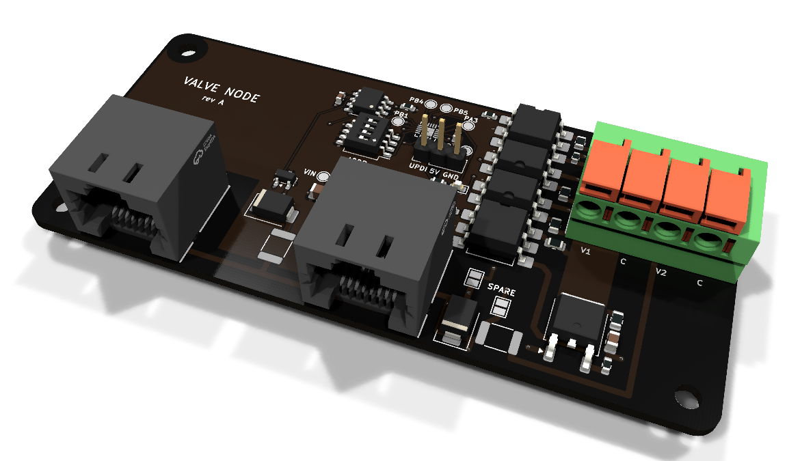
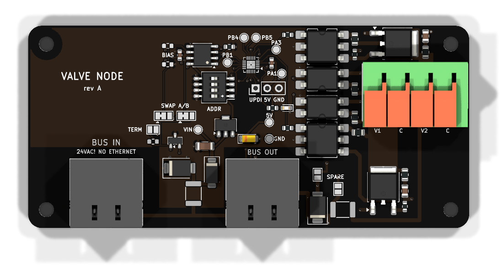
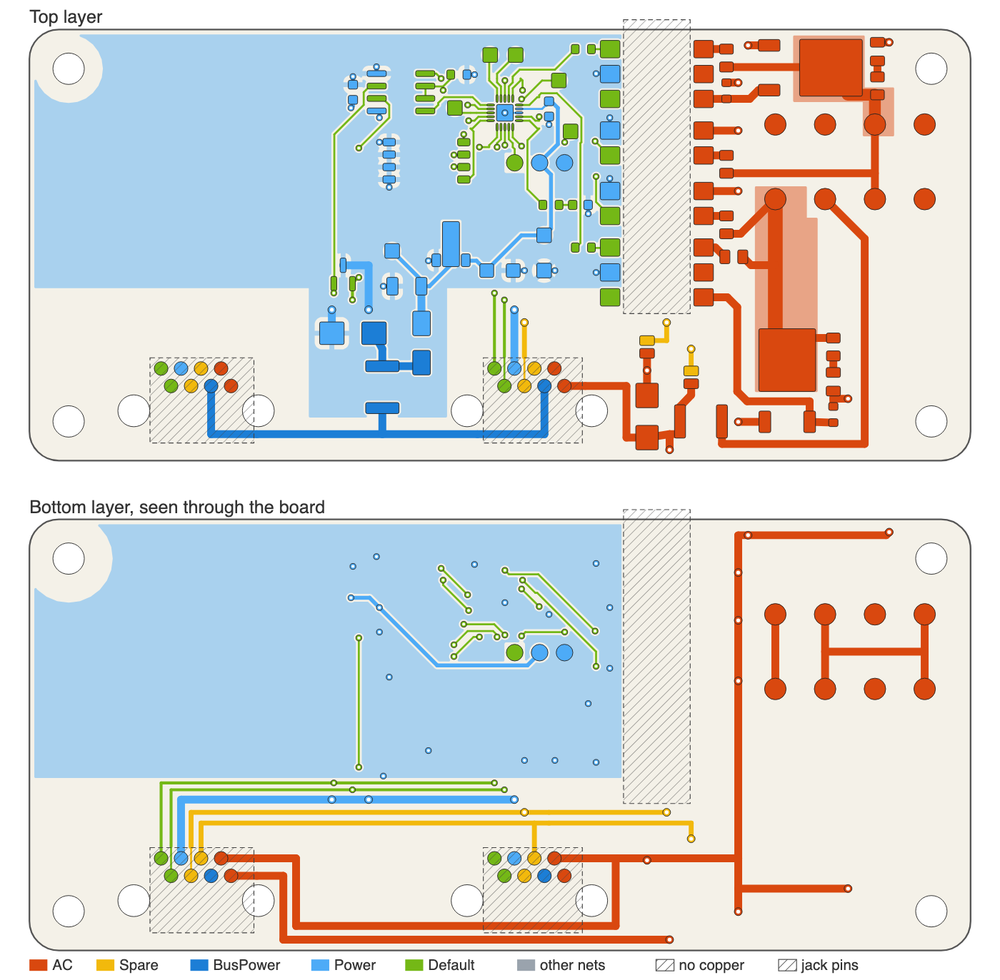
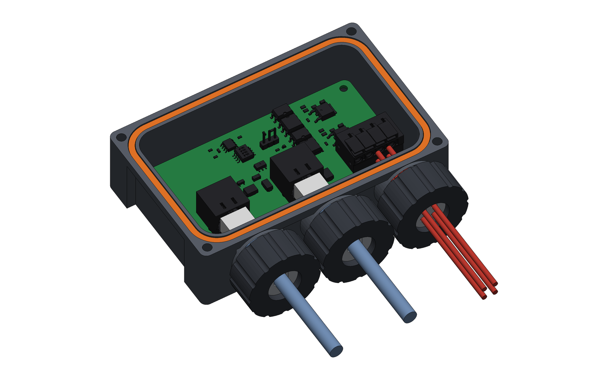
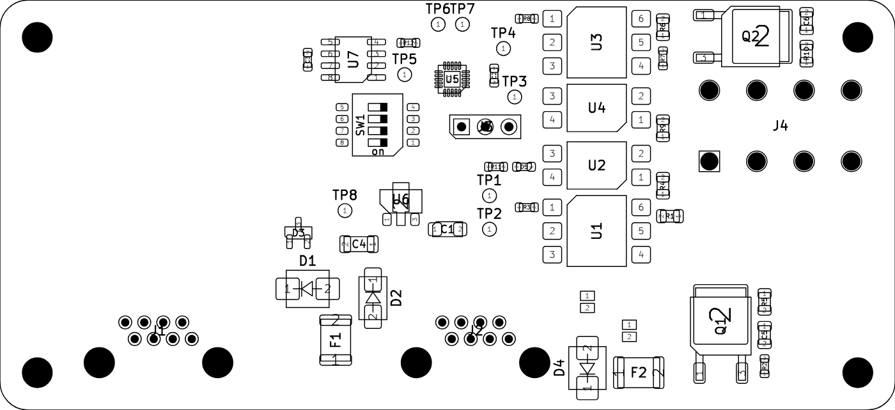

# Valve node: layout and fabrication data

The third of three hold points for the valve node. No board is ordered before the owner signed
this page off, together with the renders, the reports and the test fit. Only the owner orders.

Status: proposal, 2026-11-14. Nothing is ordered, nothing is printed.

The circuit is in [`valve-node-spec.md`](valve-node-spec.md) and
[`valve-node-schematic.md`](valve-node-schematic.md), the box and the board outline in
[`valve-node-enclosure.md`](valve-node-enclosure.md). This page says where the parts sit and why,
how 24 VAC is kept away from the logic, what was checked, what the order costs and how to try the
fit before ordering.

## What to review

One command builds everything: `make all BOARD=valve-node` (about two minutes).

| Output | Command | File |
|---|---|---|
| Renders: top, bottom, at an angle | `make render BOARD=valve-node` | `build/valve-node/render-*.png` |
| Copper by net class, both layers | `make plots BOARD=valve-node` | `build/valve-node/plots/classes.svg` |
| Copper per side, assembly drawing with reference designators | same | `build/valve-node/plots/copper-*.svg`, `assembly-top.svg` |
| 1:1 print of the board for a test fit | same | `build/valve-node/plots/valve-node-1to1.pdf` |
| Design rules check | `make drc BOARD=valve-node` | `build/valve-node/drc.rpt` |
| Gerber and drill files, JLCPCB BOM and placement file, board STEP | `make fab BOARD=valve-node` | `build/valve-node/fab/` |
| Board in the enclosure, pictures and collision check | `make enclosure collide BOARD=valve-node` | `build/valve-node/views/`, terminal |

Sources: [`layout.py`](../boards/valve-node/layout.py) (every position, every rule, every scripted
track), [`mech.json`](../boards/valve-node/mech.json) (outline, holes, connector positions),
[`tools/kilayout.py`](../tools/kilayout.py) and [`tools/gridroute.py`](../tools/gridroute.py).

## Where the parts sit

96 × 44 mm, two layers, every part on the top side. Outline, mounting holes and the four
connectors on the lower edge come from the enclosure.

| Area | Parts | Why there |
|---|---|---|
| Right third | Triacs, snubbers, gate and monitor resistors, valve headers | The 24 VAC side. Each triac's tab faces its valve header |
| One column at x = 64 mm | The four optocouplers | The only parts that span the isolation gap. Their pin rows are 7.5 mm apart, and nothing else crosses that line |
| Right of the OUT jack | 24 VAC TVS, valve fuse, the two spare-pair jumpers | The 24 VAC pair leaves the jack here, so the TVS is the first part on the pair |
| Between the jacks | 12 V fuse, 12 V TVS, series diode; RS485 TVS just above | Every bus wire passes here on its way from jack to jack, so each TVS sits on the wire it protects |
| Above the jacks | Regulator, transceiver with its jumpers, microcontroller, address switch, programming pads | Logic. The microcontroller's output pins face the optocouplers, its UART pins the transceiver |
| Left third | Empty, ground copper | The outline is as long as the enclosure needs for three cable entries; the circuit needs less |

## 24 VAC and logic

Orange is everything that carries 24 VAC, yellow the spare pair, blue and green the logic. The
hatched strip is the isolation gap.

The rules of the specification ("Layout rules") are not a drawing convention but design rules in
the KiCad project (`boards/valve-node/eda/valve-node.kicad_dru`, written by `layout.py`). KiCad's
DRC checks them on every run:

| Rule | Value | How it is met |
|---|---|---|
| 24 VAC to anything else | 3.0 mm | The smallest distance on the board is 4.9 mm (a jumper pad to an optocoupler's unused pad). Along the gap, logic ends at x = 60.4 mm and 24 VAC starts at x = 67.8 mm |
| Inside class 24 VAC | 0.5 mm, tracks 0.8 mm | All 24 VAC tracks are 0.8 mm, the two valve tracks 1.5 mm |
| No copper under the optocouplers | both layers | A strip of 6.8 mm between the pin rows, over the whole column |
| Ground zone on the logic half only | | Two zones, both end at x = 60.4 mm and above the pass-through |
| Bus power | 0.8 mm | +12 V and ground from jack to jack |
| Spare pair | 3.0 mm to logic once it has left the pass-through | It can be bridged to the 24 VAC pair, so east of the OUT jack it is treated like it. Smallest distance there: 3.25 mm |
| Triac cooling | at least 0.5 cm² under each tab | 0.77 cm² (output 1) and 1.40 cm² (output 2), each joined to its valve header pin |

### The one exception: the jack

Inside the jack, 24 VAC and +12 V are neighbours at 1.02 mm pitch. The specification accepted
that. The rule is relaxed to 0.4 mm in two small areas around the pin fields (hatched, "jack
pins"), and only between two items that both lie inside. The smallest distance there is 0.65 mm,
between the pads of 24 VAC b and +12 V.

That distance was 0.45 mm with the footprint as fetched (pads 1.6 mm, holes 1.0 mm). The pads are
now 1.4 mm with 0.9 mm holes, which is what Amphenol's drawing asks for (0.89 mm), and the two
plastic pegs are unplated holes of 3.25 mm; they were plated holes without a pad.

The fetched footprint is from the EasyEDA library that LCSC's engineers draw for JLCPCB's parts.
Its holes were 0.1 mm larger than Amphenol's, most likely as a margin for the board maker's
tolerance, and that margin is gone now. What is left: JLCPCB makes a plated hole between 0.08 mm
smaller and 0.13 mm larger than ordered (capabilities page, read 2026-11-15), so a 0.9 mm hole
comes out between 0.82 and 1.03 mm. The jack's contact tails are 0.43 × 0.35 mm in its 3D model,
0.55 mm across the diagonal, which leaves 0.27 mm in the smallest hole. The pad keeps a ring of
0.25 mm around the hole, which is what JLCPCB recommends for a two-layer board; a 1.0 mm hole in
a 1.4 mm pad would leave 0.20 mm. Neither the tolerance on Amphenol's drawing nor the tail's
size was read from an Amphenol document; the 3D model came with the fetched footprint.

### The pass-through

Eight wires go from jack to jack, and the two jacks have the same pin order, so every wire has to
cross every other one once. How they do it decides how close 24 VAC comes to the logic.

- **North of the pins, bottom layer:** RS485 A and B, ground, and the spare pair, as five lanes.
  They leave the IN jack nested, without crossing. At the OUT jack each lane ends in a via and
  drops to its pin on the top layer. B and spare 2 are on the inner pin row and pass between two
  pads of the outer row with a 0.2 mm track and 0.22 mm on each side.
- **South of the pins, bottom layer:** the 24 VAC pair, 0.8 mm, along the board edge under the
  jacks. No via. It reaches the OUT jack from the right, through the TVS.
- **South of the pins, top layer:** +12 V. It is the only logic wire on that side, and it runs
  above the 24 VAC pair with the board between them: 1.6 mm of FR-4 instead of a gap on the
  surface.

Between the jacks, 24 VAC keeps the full 3 mm from every logic track on its own layer. The spare
pair does not. It runs next to the ground lane at 0.65 mm, as it does inside the cable. With its
jumpers open it is connected to nothing.

### Surge paths

| Pair | Path |
|---|---|
| RS485 | Each lane rises through a via straight into its TVS pad. The TVS's ground pad returns to the ground lane through 7 mm of 0.8 mm track and a via |
| +12 V | Lane, 2.7 mm to the fuse, 4 mm on to the TVS; the edge of the TVS's ground pad is 1.2 mm from a via into the ground lane |
| 24 VAC | Wire a passes through the TVS pad on its way to the OUT jack's pin. Wire b reaches the TVS through a via 1.3 mm from the pad |

### Valve outputs

The two outputs are the same pattern, one above the other: optotriac, triac level with its gate
pin (3 mm of straight gate track between the two pads), gate-to-A1 resistor beside it, the row of gate, monitor and
snubber parts above. 24 VAC b reaches every part from a 0.8 mm trunk on the bottom layer through
seven vias, so the top layer needs no crossing. The valve current flows trunk, via, triac, tab,
copper area, header pin.

## The logic side

Everything above is drawn in `layout.py` by coordinates. The remaining 28 logic nets are connected
by a small router of this repository ([`tools/gridroute.py`](../tools/gridroute.py)): 0.1 mm grid,
two layers, 45° bends, shortest path first, no second attempts. It works inside a region that
ends before any 24 VAC copper, so it cannot come near it.

The throwaway board uses Freerouting. On this board Freerouting left 8 to 13 connections open
around the microcontroller in every run and wrote three tracks below the minimum width
([`toolchain.md`](toolchain.md), "What does not hold up"). The router here is cruder, but the same
input gives the same copper on every run, and a net that finds no way stops the build with its
name and a map of what blocks it.

- The microcontroller's pins are 0.4 mm apart. `layout.py` leads them outwards as a fan to
  0.8 mm pitch, where a via fits beside a neighbour's track; the router continues from there.
- Signal tracks are 0.2 mm with 0.2 mm space, supply tracks 0.4 mm.
- The address switch and the transceiver have their pins in the opposite order to the
  microcontroller's. The specification allows swapping pins for that; this layout does not use
  it and crosses on the bottom layer instead, so the pin assignment of the specification stands.
- Ground is a zone on each layer. Every ground pad also has its own via to the bottom zone,
  because the tracks cut the top zone into islands.

## Checks

| Check | Result |
|---|---|
| KiCad DRC, all severities, including the custom rules above | 0 violations, 0 unconnected pads |
| The 3 mm rule can fail: a ground track drawn 2.5 mm from 24 VAC copper on a copy of the board (`make selftest`) | reported, as it must be |
| The isolation gap can fail: a track drawn under an optocoupler | reported |
| The screw head keep-out can fail: a track drawn under a screw head | reported |
| Board STEP against every enclosure part (`make collide BOARD=valve-node`) | no overlap, 6 parts |
| Height: 14.8 mm above the board's bottom face, 2.4 mm below it | limits from the enclosure: 18 mm above the board, 3.5 mm below |
| Jack orientation in the render and in the enclosure section | plug opening faces the cable entry |
| Schematic: unchanged by the layout, ERC | 0 violations |
| Every populated part has an LCSC number (`make fab`) | 26 BOM lines, 39 placements |

The second and third self-test exist because of what the first version found: KiCad 10.0.1 did
not report a track inside a rule area that forbids tracks. The DRC report was clean and the check
was blind. Both keep-outs are now explicit rules in the rule file, and both are tested.

## Deviations

| # | Before | This layout | Reason |
|---|---|---|---|
| 1 | Bus jack footprint as fetched: pads 1.6 mm, holes 1.0 mm, pegs as plated holes of 3.3 mm | Pads 1.4 mm, holes 0.9 mm, pegs unplated 3.25 mm | Amphenol's drawing (schematic page, "Handed to the layout"); 0.65 mm instead of 0.45 mm between the 24 VAC and +12 V pads; a track fits between two pads |
| 2 | Valve headers at x = 79.92 and 90.08 mm | 79.72 and 90.28 mm | The two headers were exactly 10.16 mm apart, body against body by the drawing. Now there are 0.4 mm between them. `mech.json` changed, the collision check passes |
| 3 | Fuses and triacs: the manufacturers draw longer land patterns than KiCad's (schematic page) | KiCad's patterns kept | They are the IPC-7351 patterns for reflow, which is how JLCPCB solders them. The longer ones add toe length for hand and wave soldering. The triac's cooling comes from the copper area, not from the pad |
| 4 | Silkscreen with reference designators | Function labels only: jacks, valves, jumpers, test pads, programming pads | 60 footprints leave no room. The assembly drawing has the designators |
| 5 | Jack and header silkscreen as fetched | Outline shortened to inside the board edge and off the pads | They drew over the edge and over pads; DRC reports both |
| 6 | Specification: one clearance for the 24 VAC class | A second class for the spare pair | Open jumpers leave it floating; bridged, it is 24 VAC. It gets the 3 mm wherever it is not between the bus lanes |

Not changed: the schematic, the pin assignment, the bill of materials, the board outline.

## Fabrication data

`make fab BOARD=valve-node` writes to `build/valve-node/fab/`:

| File | Content |
|---|---|
| `valve-node-gerbers.zip` | Copper, mask, paste, silkscreen, outline, drill files for plated and unplated holes |
| `valve-node-bom-jlcpcb.csv` | 26 lines with LCSC numbers |
| `valve-node-cpl-jlcpcb.csv` | 39 placements: 35 surface-mount parts and the 4 through-hole connectors |
| `valve-node.step` | The populated board, used by the collision check |

To choose when ordering: 2 layers, 1.6 mm, 1 oz copper, lead-free HASL, quantity 5; "Specify a
location" for the order number (the text `JLCJLCJLCJLC` on the bottom silkscreen marks the
place); assembly of the top side, Economic.

What the files cannot guarantee, to check in JLCPCB's own preview before paying:

1. **Rotation of each polarised part.** JLCPCB's reel orientation differs from KiCad's for some
   packages, and only their placement preview shows it. To look at: series diode D2, tantalum
   capacitor C1 (the marked end is +), status LED D5, microcontroller U5, transceiver U7,
   optocouplers U1 to U4 (pin 1 dot towards the logic side on U1 and U3, towards the 24 VAC side
   on U2 and U4), triacs Q1 and Q2, regulator U6, RS485 TVS D3, switch SW1. A wrong one is
   corrected with `rotation_offset` in `lib/jlcpcb-parts.csv`, then `make fab` again.
2. **Stock and class of every part**, as listed in the specification on 2026-11-14. The jack had
   617 in stock.
3. **Whether Economic assembly takes a board of 96 × 44 mm as it is** or adds rails. Not looked up.

## Cost estimate

For five boards, all five assembled. Four nodes are installed today, one is a spare, and JLCPCB
makes at least five bare boards anyway. Fees are from JLCPCB's assembly price page (updated 2026-10-22),
part prices from the specification (JLCPCB parts search, 2026-11-14). US dollars, without shipping
and import VAT.

| Item | 5 boards | 10 boards |
|---|---|---|
| Bare boards, 96 × 44 mm, 2 layers. From $2 for five; the surcharge for lead-free HASL was not found, $3 assumed | 5 | 8 |
| Set-up 8.18, stencil 1.53, placement confirmation 0.45 | 10.16 | 10.16 |
| Extended parts: 13 surface-mount part types × 3.07 | 39.91 | 39.91 |
| Surface-mount joints: 117 per board × 0.0016 | 0.94 | 1.87 |
| Parts, about $9 per board | 45 | 90 |
| Through-hole soldering by JLCPCB: 3.58 per order + 20 joints per board × 0.0164 | 5.22 | 6.86 |
| **Sum** | **about 106** | **about 157** |
| Per board | about 21 | about 16 |

With shipping to Germany (not looked up, $15 to $25 assumed) and 19 % import VAT, five boards come
to about $145 to $160, ten to about $205 to $220.

The 13 extended part types are almost 40 % of a five-board order and do not grow with the
quantity. If JLCPCB charges the extended fee for the two through-hole part types as
well, add $6.14. JLCPCB rounds cheap parts up to a minimum quantity; a few dollars.

Not in the sum, bought elsewhere: two plugs KF2EDGK-5.08-2P per board (C440880, $0.15), RJ45
plugs for solid wire, eight M3 heat-set inserts and eight screws per enclosure, filament, a UPDI
programmer.

### Who solders the through-hole parts

Decided by the owner on 2026-11-15: JLCPCB solders them. The question was open since the
schematic hold point. Each board has two jacks and two headers, 20 joints.

| | JLCPCB | Owner |
|---|---|---|
| Cost for five boards | $5.22, perhaps $6.14 more | nothing extra; the connectors come with the plug order from LCSC |
| Work | none | 100 joints |
| Risk | The footprints of jack and header are checked against the drawings, never against a part. If one does not fit, JLCPCB asks before soldering | The same misfit is found at home, with five boards already made |
| In the files | `tht` in `lib/jlcpcb-parts.csv` (as now) | `none` for both parts, then `make fab` |

Why JLCPCB: it costs about as much as the shipping of the loose connectors would, and a footprint
that does not fit is found before the boards leave the factory. The files are already set that
way, and the cost estimate above includes it.

## Test fit

The owner does it before the order. No check here can say whether the real print holds a board of
this outline and whether the cables arrive where the jacks are.

1. `make enclosure BOARD=valve-node`, then print from `build/valve-node/print/`: `base.stl`,
   `lid.stl` and `board-dummy.stl` (any material; the dummy is the outline with its four holes
   and the connectors as blocks of their real size, flat side down).
2. Or, without printing a dummy: print `build/valve-node/plots/valve-node-1to1.pdf` on paper at
   100 %, measure the 50 mm line beside the board, cut along the outline.
3. Lay the dummy on the four standoffs. To look at:

| Look at | Expected |
|---|---|
| The four holes | each over its standoff; an M3 screw goes through |
| Gap to the three walls without entries | 2 mm all around |
| Jack blocks | each centred on its cable entry, 14 mm from the entry wall |
| Lid | closes without touching a block (dummy only) |
| A crimped bus cable | passes through an entry, nut off, and reaches the jack block in a straight line |

The same print is the first sample for the water bath test
([`valve-node-enclosure.md`](valve-node-enclosure.md), "What does not hold up yet").

## What does not hold up yet

1. **No part was ever placed on these footprints.** Jack and header are fetched LCSC footprints,
   corrected against the manufacturers' drawings by hand. The first assembled board is the test.
2. **Placement rotations are unverified** (see "Fabrication data").
3. **The test fit is not done.** The collision check compares models, not prints.
4. **The router has no second attempt.** A change in placement can leave a net without a way.
   The build then stops and prints a map; the fix is a position or the order of the nets in
   `layout.py`. It takes 45 seconds, most of `make layout`.
5. **The 24 VAC pair crosses under the +12 V lane** at the jacks, on the other layer. That is by
   design, and it is the place to look first if a board ever shows leakage between the two.
6. **The spare pair runs between the logic lanes** on the pass-through. Bridged to 24 VAC, it has
   0.65 mm to the ground lane on 34 mm of length. The specification allows it; it is the reason
   to bridge the spare pair only if the far valve really does not pull in.
7. **A via sits in the microcontroller's exposed pad**, 0.3 mm drill, not plugged. Some solder
   will wick into it. One via, under a part of 3 × 3 mm; it is the only way to tie that pad to
   the bottom ground.
8. **No reference designators on the board.** Fault finding needs the assembly drawing
   (`build/valve-node/plots/assembly-top.svg`) beside it.

## Open points

| Point | Needed for | Who, when |
|---|---|---|
| Test fit with a printed enclosure | Sign-off | Owner, before the order |
| Rotations, stock and class in JLCPCB's preview | Order | Owner, while ordering; corrections go into `lib/jlcpcb-parts.csv` |
| Price of lead-free HASL, shipping, board size limit of Economic assembly | Cost | Shown in JLCPCB's quote |
| The points listed in the specification's and the schematic's "Open points" | | unchanged |

## Sources

| Document | Used for |
|---|---|
| JLCPCB, *What does your PCB assembly price include?*, help article, updated 2026-10-22 | Set-up, stencil, extended part, joint and hand-soldering fees |
| JLCPCB, special offer for 1 to 2 layer boards up to 100 × 100 mm | Bare board price |
| JLCPCB, *PCB manufacturing capabilities*, read 2026-11-15 | Tolerance of plated holes, recommended ring around a hole |
| Amphenol, *Modular Jack, RJHSE Series*, RJHSE-508X page | Hole and peg diameters of the jack |
| STMicroelectronics, *T4 series, 4 A triacs*, DocID7699 Rev 9, table 6, p. 3 | Copper area under the tab |
| Texas Instruments, *THVD2410, THVD2450*, SLLSF20B, 11.1, p. 21 | TVS placement and return path |
